# Games audit, A–L

Played 27 Oct 2026 on this branch, before any gameplay edits. Headless Chrome (Playwright, SwiftShader) at 1400×816, served from the repo root. Each game loaded fresh, the title was dismissed when it had one, then a short real input sequence (keys, clicks, or a drag). Two frames were saved under `docs/audits/shots/`. No page threw. Scores are from that session plus the rules on screen, not from `docs/GAME_QUALITY.md`.

Fun is “would the next five minutes pull you in on a family desk.” Quality is polish, clarity, juice, and whether the first screen is fair. 7 is the bar already set by Little Lake, After Hours, and Forge Arena’s hangar. After scores are from a second headless pass on the same viewport, after the edits below. Unchanged games keep the before score.

| Game | Fun before | Quality before | Fun after | Quality after |
| --- | --- | --- | --- | --- |
| Astray | 2 | 2 | 6 | 6 |
| Doom (Freedoom) | 3 | 3 | 3 | 4 |
| Dino | 5 | 3 | 6 | 5 |
| Cloud Courier | 4 | 4 | 6 | 6 |
| Copper & Steam | 4 | 4 | 6 | 6 |
| Kiln & Kind | 4 | 4 | 6 | 6 |
| Lumen Grove | 4 | 4 | 6 | 6 |
| Bolt & Bristle | 5 | 4 | 6 | 6 |
| 2048 | 6 | 4 | 6 | 6 |
| Deep Pocket | 4 | 5 | 6 | 6 |
| Little Foundry | 4 | 5 | 5 | 6 |
| Circuit Garden | 5 | 5 | 6 | 6 |
| Glasshouse | 5 | 5 | 5 | 5 |
| Harbourlight | 5 | 5 | 6 | 6 |
| Inkline | 5 | 5 | 6 | 6 |
| Last Match | 5 | 5 | 5 | 5 |
| Copper Cadence | 6 | 5 | 6 | 6 |
| Afterlight (the shelf) | 6 | 6 | 6 | 6 |
| Borrowed Gravity | 6 | 6 | 6 | 6 |
| Burrow Express | 6 | 6 | 6 | 6 |
| Echo Vault | 6 | 6 | 6 | 6 |
| Hextris | 7 | 6 | 7 | 7 |
| Lucky Company | 6 | 6 | 6 | 6 |
| Ashwake | 7 | 7 | 7 | 7 |
| Forge Arena | 7 | 7 | 7 | 7 |
| Hollow Keeper | 7 | 7 | 7 | 7 |
| Lanternwake | 7 | 7 | 7 | 7 |
| Autumn Drift | 7 | 8 | 7 | 8 |
| Little Lake | 7 | 8 | 7 | 8 |
| Lost & Found | 7 | 8 | 7 | 8 |
| After Hours | 8 | 8 | 8 | 8 |
| Counterweight | 8 | 8 | 8 | 8 |

Steam comparisons are about the feel those games are known for. No assets or code were taken from them.

## 2048

Fun 6. Quality 4. The board works: eight arrow moves merged tiles up to an 8 and the score ticked 0 → 24.

Broken: nothing crashed. New Game sits in the header, which is the control the quality bar says should not be the first click. There is no pause.

Boring or confusing: the how-to-play paragraph never leaves. There is no sound, no goal beyond the static line “get to the 2048 tile,” and no sense of a run.

Missing versus Threes / modern 2048: an undo, a theme, a daily board, and a moment when a big tile actually feels like an event.

1. Add pause, and move New Game off the first click.
2. Hide the essay after the first merge, and pop a small banner on each new high tile.
3. Add undo (one step) and a saved best that is more than the stock counter.

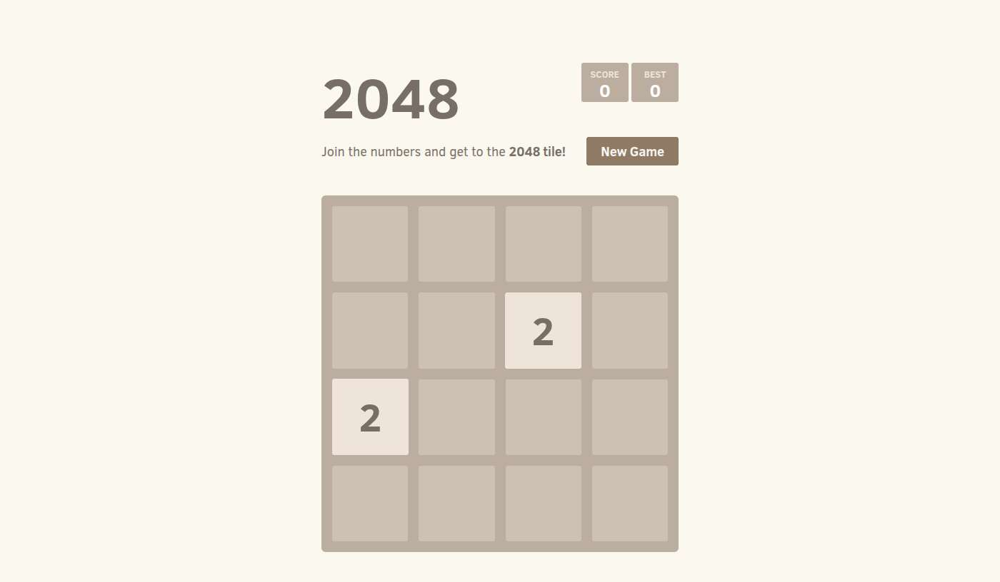
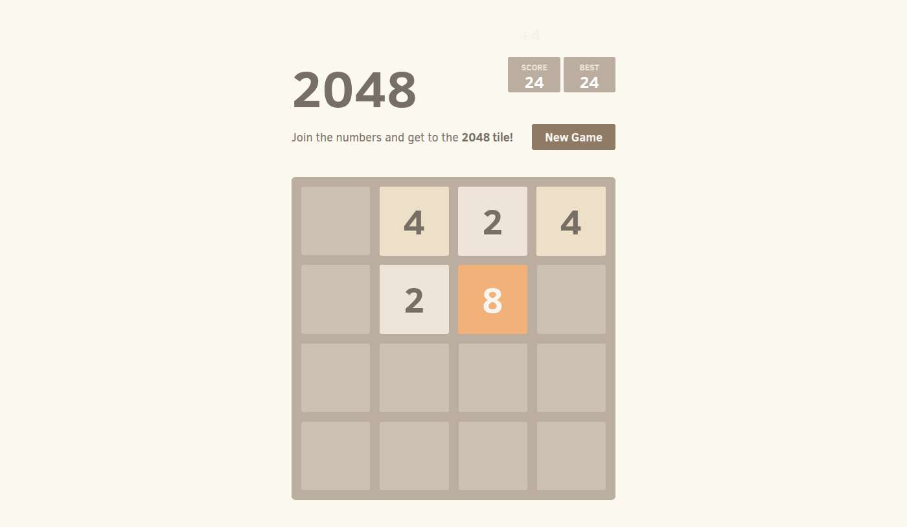

## After Hours

Fun 8. Quality 8. A pair of queens scored 170 with a visible chips × mult burst. Jokers, blinds, antes, and a shop are all on the table. This is already at the bar. Leave the rules alone.

Broken: none in this session. Sound starts off.

Boring: the reference panel is a wall, which is fine once you know the hands, and heavy on a first night.

Missing versus Balatro: the scoring theatre is close. A quieter first blind coach would help, and it is not required for this pass.

1. Leave the scoring model.
2. Optional later: a one-line coach on the first blind only.
3. Optional later: sound on by default with the existing toggle.

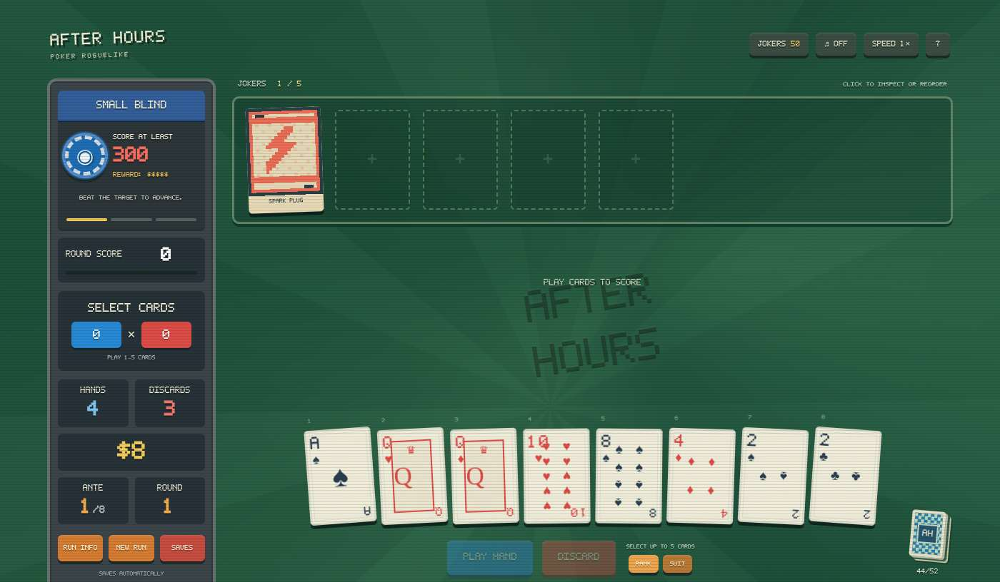
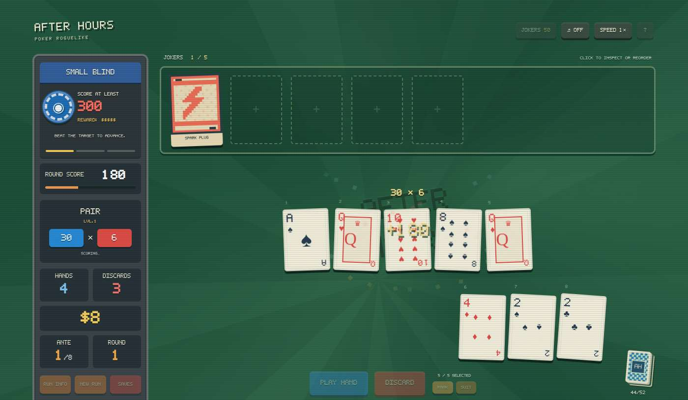

## Afterlight (the shelf)

Fun 6. Quality 6. The shelf of ten cards is the nicest screen in this group. Opening the first card drops into Harbourlight with the side essay still open. The five games in this letter range (Harbourlight, Kiln & Kind, Cloud Courier, Copper & Steam, Lumen Grove) are the same small canvas toy with a chapter counter. Velvet Circuit, Tidal Glass, Orchard Atelier, Moonwell, and The Quiet Cut live in the same file and are out of scope.

Broken: none. Sound defaults off. Keyboard input is ignored until the canvas has focus, and several games draw no “you are here” marker until a key has already landed.

1. Ease chapter 1 only for the five in-scope games, without changing the other five.
2. Show the keyboard cursor before the first key, and play a tiny sound when an action lands.
3. Cut the first-chapter goal so a round ends before the toy repeats.

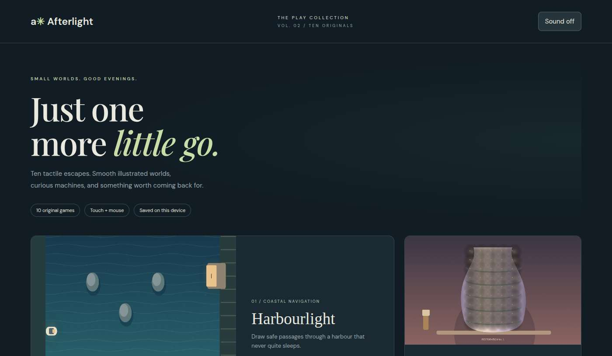
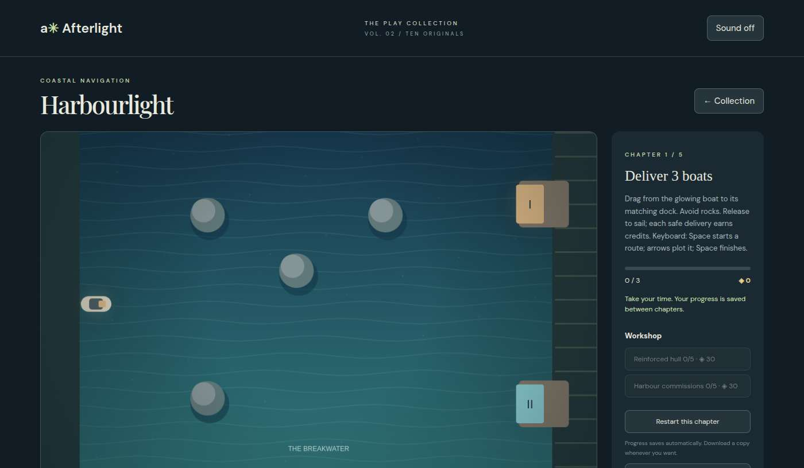

## Ashwake

Fun 7. Quality 7. Title, two walkers, relics, achievements, and a night clock. After Walk as the Warden the orchard was moving: 3 moths, a gather ring, a lantern. Strong enough to leave.

Broken: none seen. The first seconds are dark, which is the mood, and the coach line is easy to miss under the bars.

Missing versus Vampire Survivors: the build choices are there. The first minute could show one obvious moth dying to the lantern so the fantasy lands faster.

1. Leave the night loop.
2. Optional: a single scripted moth that crosses the ring in the first five seconds.
3. Optional: a brighter lantern halo on night 1 only.

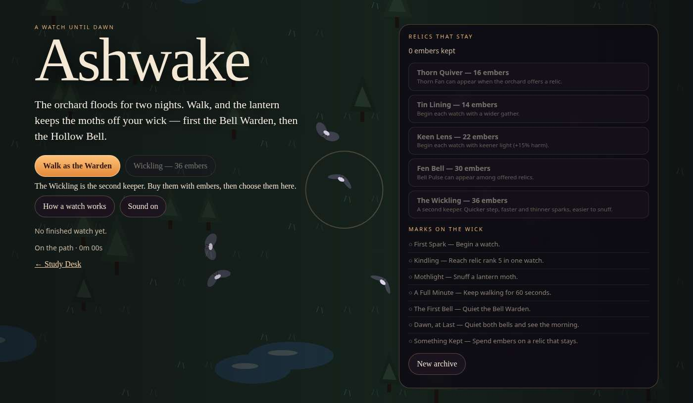
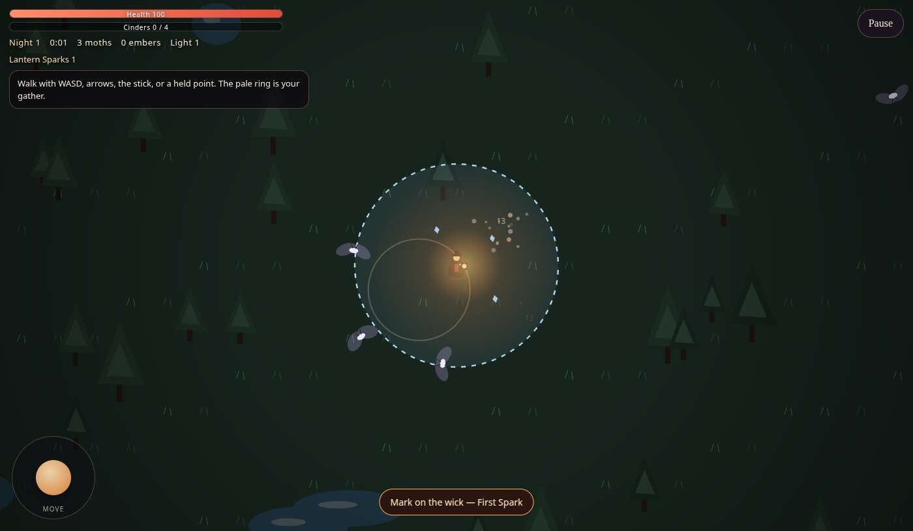

## Astray

Fun 2. Quality 2. This is the weakest game in the set, and it is broken.

Broken: the maze never draws. Chrome logs `THREE.WebGLRenderer 49` and a string of `WebGL: INVALID_OPERATION … program not linked` from the old Phong materials. The canvas stays black. `gameState` does reach `play`, so the physics loop is running inside an invisible level. Instructions appear only while I is held. There is no pause, no touch, and no saved progress.

Boring: with a working maze this would be a marble roll. Right now there is nothing to learn.

Missing versus Marble It Up / a simple labyrinth: a visible maze, a ball you can see, a short first maze, and a cheer at the exit.

1. Make the ball, walls, and floor draw on current Chrome (drop the unlinked Phong shader).
2. Put the controls on screen, and add pause.
3. Start on a smaller maze than 11×11, and keep the level number in the save.

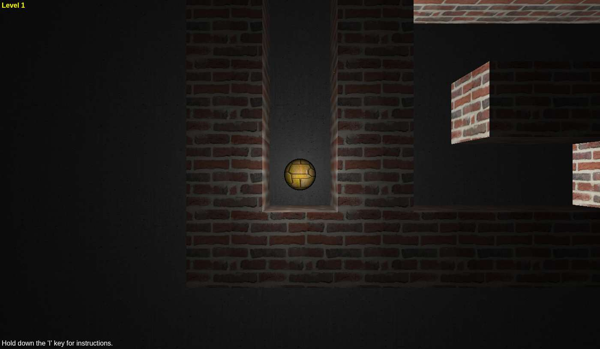
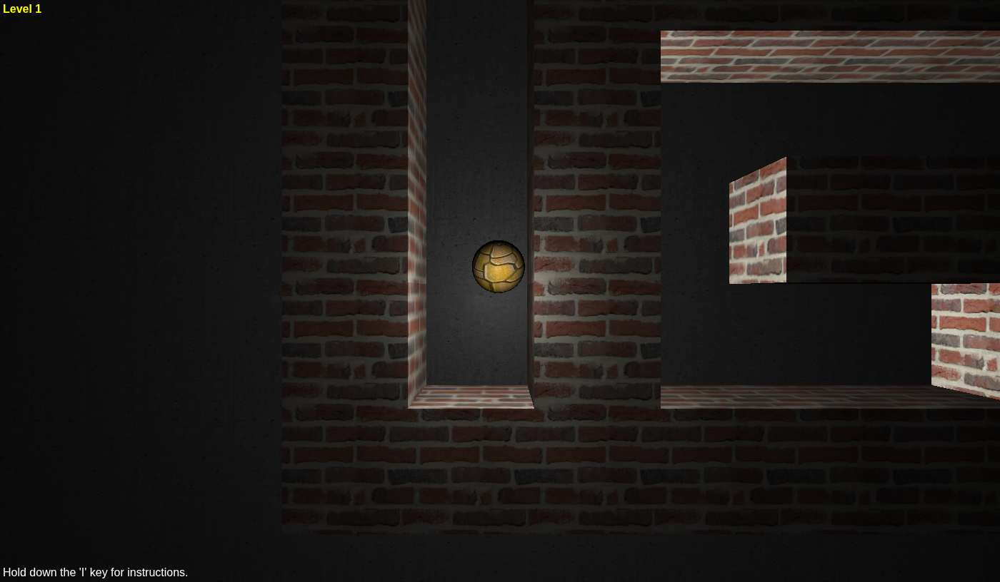

## Autumn Drift

Fun 7. Quality 8. Pixel lawn, basket, acorn count, and a real area curve (36 leaves on area 1). A short drag in this session did not catch a leaf, so the first click still needs to be on a leaf, but the garden reads immediately. At the bar. Leave it.

1. Leave the blower.
2. Optional: a leaf under the opening pointer.
3. Optional: nothing else.

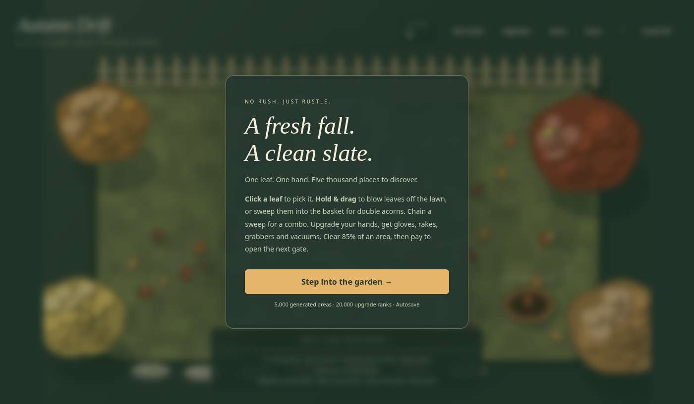
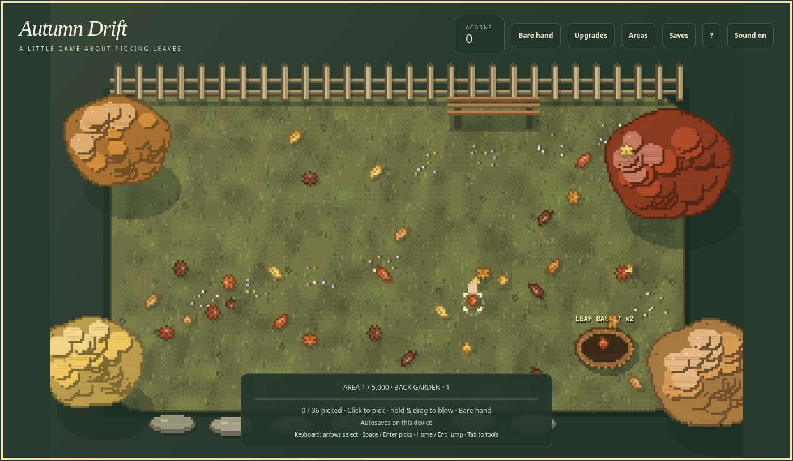

## Bolt & Bristle

Fun 5. Quality 4.

Broken: the header still says `PROTOTYPE`. The quality sheet marked Copy as pass. It is not. Plates are a copper diagram, not a machine.

Boring: every plate is the same brush → rust → screw → turn loop. Job 1 is the shortest path, so a curve exists, but rust and screws are already sprinkled on the first radio. Nothing on the bench looks repaired until a test you cannot see.

Missing versus PowerWash Simulator: dirt that visibly leaves, a before/after of one object, and a first job that is only dust.

1. Remove the prototype label.
2. Job 1: dust only, no rust and no screws, and a shorter path.
3. A cleaned plate should flash copper, and Test should play a short “it hums” beat you can see on the board.

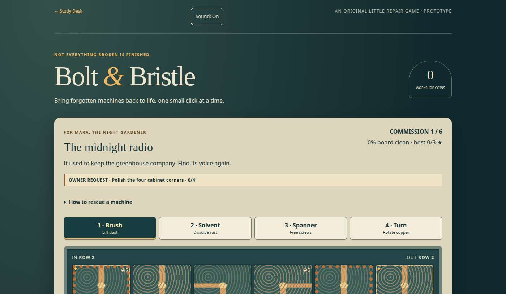
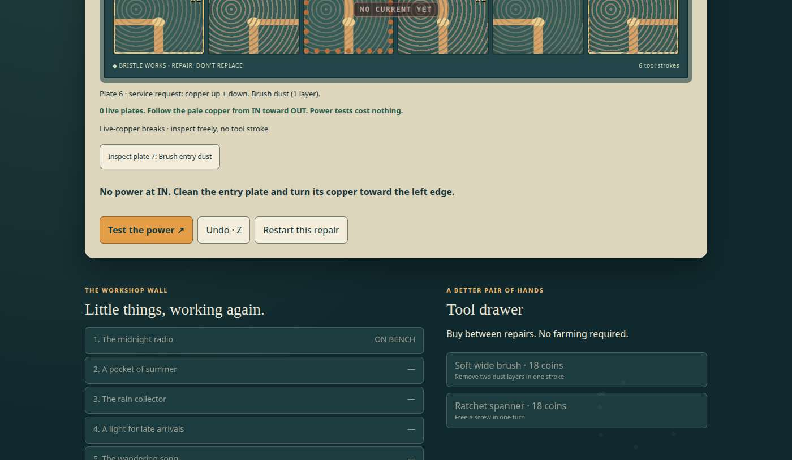

## Borrowed Gravity

Fun 6. Quality 6. Enter gallery worked. Room 1 is a real inversion puzzle with three samples and no moving hazard. Rooms 3 and 4 add the scanner and a second pull, so the curve is real. The quality sheet’s Curve fail is about feel: the first room already asks for a full ceiling crossing.

Boring: the room is a flat vector diagram. Gravity changing does not yet feel like a shove.

Missing versus Superliminal: the awe of scale. Here the fun is “which wall is down,” and the first room could teach that with one mote and a low ceiling before the three-sample route.

1. Room 1: one mote, a low gap, and a line of coach text that names the next button.
2. A visible down-arrow that flips with the borrowed pull, plus a landing thump.
3. Leave rooms 2–4 and the save records alone.

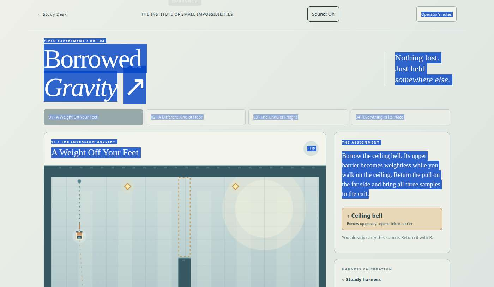

## Burrow Express

Fun 6. Quality 6. Yard 1 is a straight two-station line, which is a fair first puzzle. The sheet of forecasts is longer than the map.

Boring: you draw, press Depart, and watch. There is no passenger face, no near-miss, and no reason to care which parcel it was.

Missing versus Mini Metro: demand that grows while you look at it, and a station that gets unhappy in a way you can see.

1. Keep yard 1 as the straight lesson, and add one waving parcel that boards with a pop.
2. Yard 2 is where the first signal appears. Do not add a signal to yard 1.
3. A three-star on yard 1 should be an easy on-time delivery, not a hidden par.

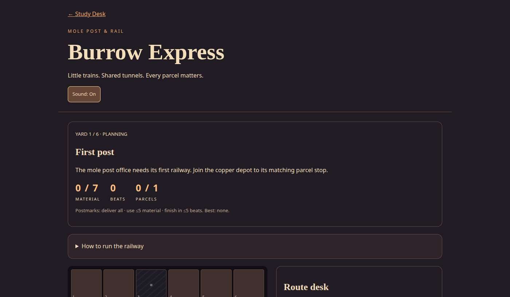

## Circuit Garden

Fun 5. Quality 5. “Link three rooftop panels” is a clear goal, and season 1 is smaller than later roofs. The screen is still a dashboard: readiness, accounting, weather, and a forecast before the first panel is down.

Boring: placing a panel does not make a garden. It updates numbers.

Missing versus Dorfromantik: a tile that clicks into a landscape and a score that blooms out of the map, not out of a sidebar.

1. Season 1 hides accounting and weather until the third panel is linked.
2. A linked bed should sprout on the roof, not only in the text.
3. Leave later seasons stricter.

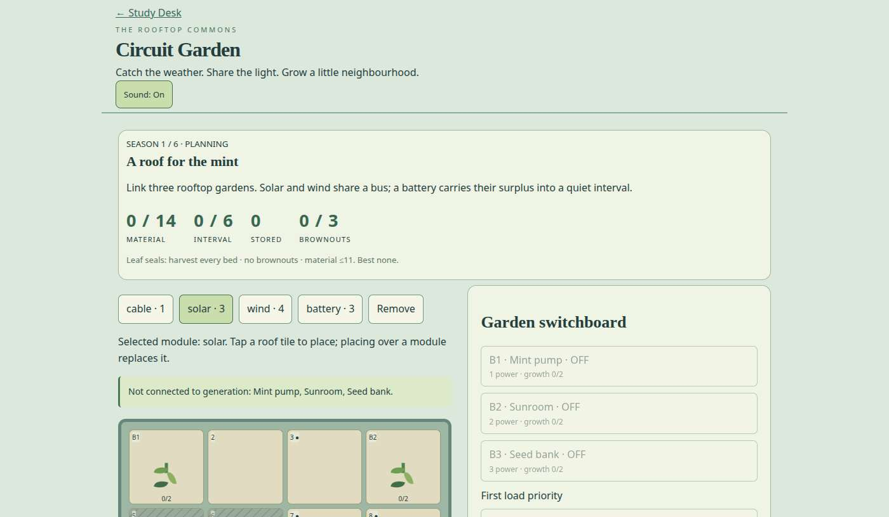
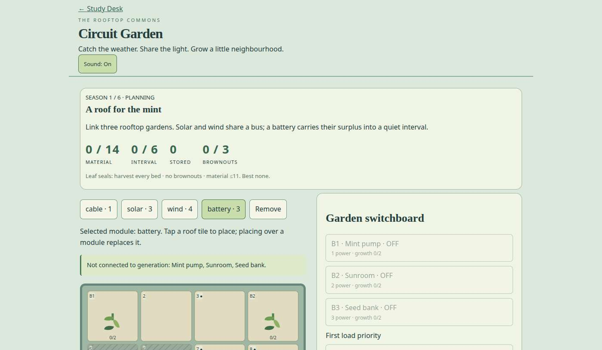

## Cloud Courier

Fun 4. Quality 4. Hold to rise, release to fall, grab parcels, dodge clouds. It reads in one second, then repeats. Chapter 1 already asks for 7 parcels, and clouds scroll at a flat pace. Sound is off. The right column restates the keys.

Missing versus Alto’s Odyssey: a horizon, a near-miss, a trick, and a run that gets faster only after you can fly.

1. Chapter 1: 3 parcels, slower clouds, no storm.
2. A shadow under the drone and a chime on each parcel.
3. Do not change the other Afterlight games’ flight code. This is game index 3 only.

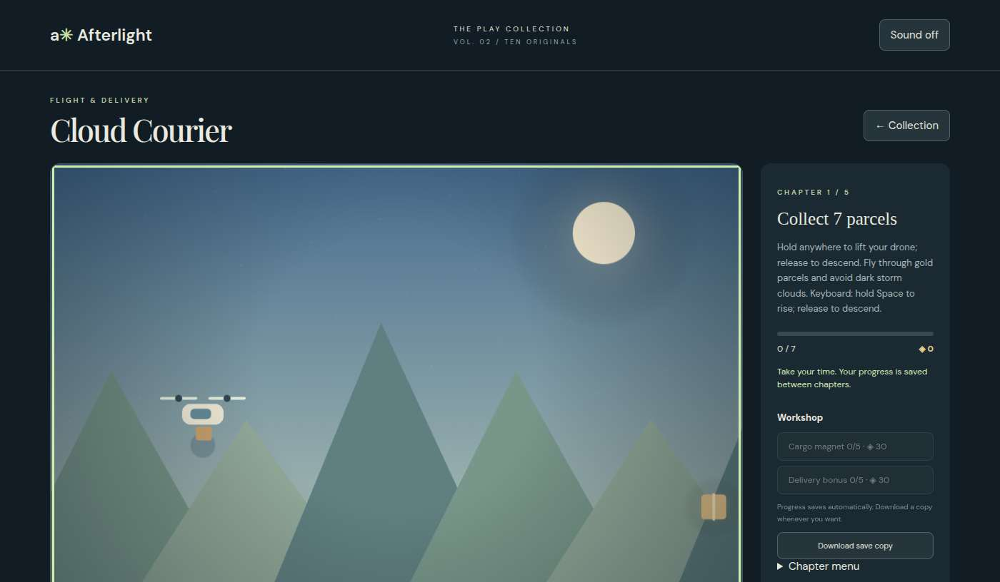
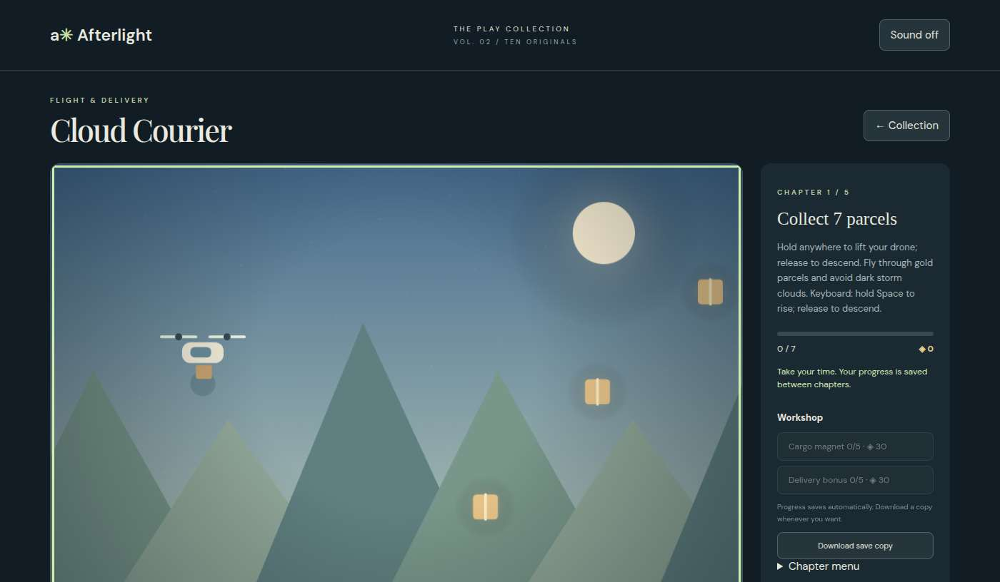

## Copper Cadence

Fun 6. Quality 5. The marble staff is a good toy, and commission 1 really is one lane with no brakes. That is a curve. What fails is the session: there is no pause, sound starts off, and the first chart is ten beats of rests with no count-in. A wrong crank is an error before you have heard the pulse.

Missing versus Rhythm Heaven: you should hear the beat you are chasing.

1. Add pause (P / Esc) without touching the save shape.
2. Sound on, and a two-beat count-in before the scored cranks on commission 1.
3. Commission 1’s chart can stay one lane. Shorten the opening rests so the first drum is beat 3, not a long wait. Keep later commissions.

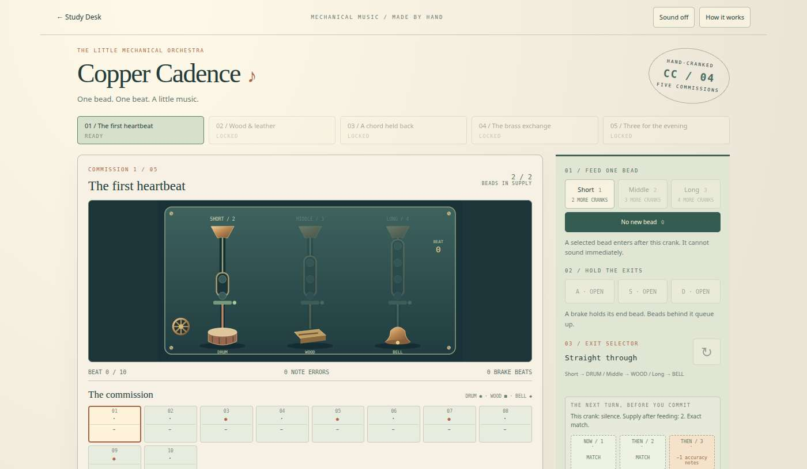
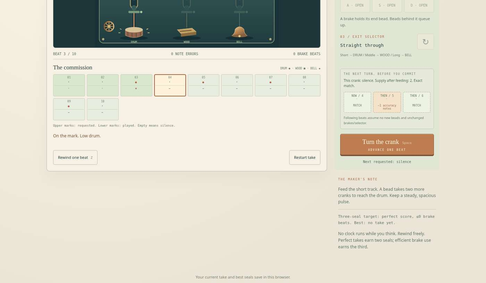

## Copper & Steam

Fun 4. Quality 4. A 4×4 of elbows. Connecting inlet to outlet is the whole game, on every chapter. Chapter number does not change the grid. No water moves until the puzzle is already solved, so you get no partial feedback. The keyboard cursor never showed in this session.

Missing versus a pipe game such as Pipe Mania: flow you can see creeping through a correct elbow, and a first board smaller than the last.

1. Chapter 1: a 2×2 that is one rotation from solved, with a visible selection ring.
2. Glow the path one pipe at a time as it connects, even before the outlet.
3. Chapters 2–5 keep the 4×4 and add one extra wrong elbow. Leave the other Afterlight puzzles alone.

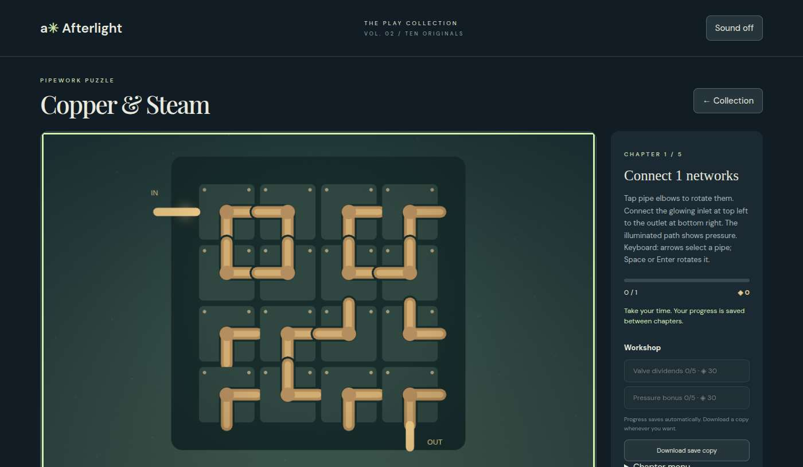

## Counterweight

Fun 8. Quality 8. Title card, foreman tip, hook, sway, and a first job that names the next move. Played through Clock in. At the bar. Leave it.

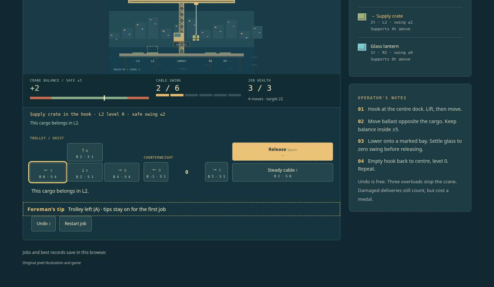

## Deep Pocket

Fun 4. Quality 5. The fishing fight is a real idea, buried under a field manual. Trip 1 already shows three banks, three depths, a sonar grid, a tide, a survey, a contract, and two briefs. The “current +0” curve is real and still feels flat because every system is on.

Missing versus Dredge: a boat, a bite that surprises you, and a fish you meet before the paperwork.

1. Trip 1: one bank, shallow only, one species, no contract. Survey can be “land a Lantern Dace.”
2. The fight should show the fish on the line, not only a tension number.
3. Keep the save version. Later trips keep the full grid.

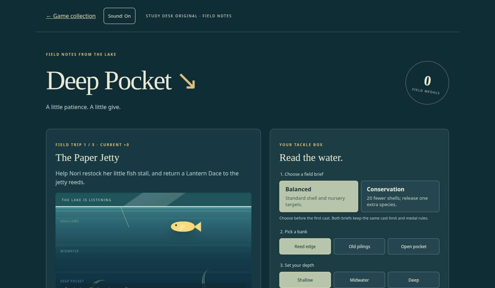
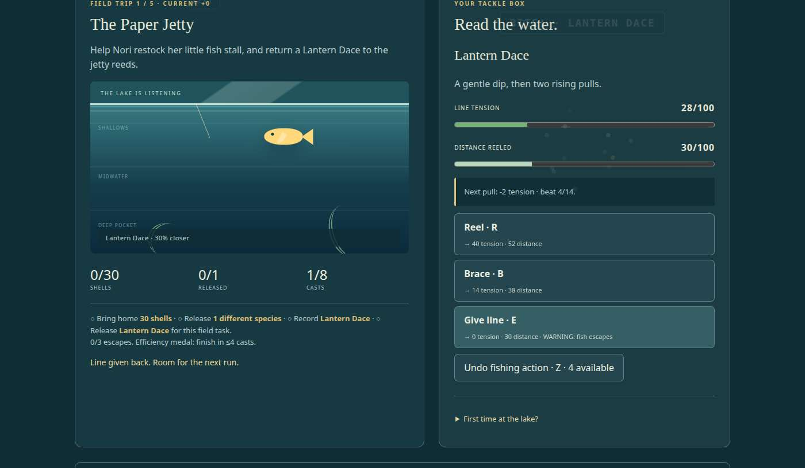

## Dino

Fun 5. Quality 3. Space starts a run and the dinosaur jumps. It is the Chrome offline page, title and all: “Press Space to start,” then a fake browser error. No pause, no medal, no Study Desk frame. The speed curve is the only progression.

Missing versus a tiny endless runner (Dino is already that game): a reason to come back other than the high score hidden in the sprite sheet, and a screen that does not look like a broken browser.

1. A small title card over the existing sprite: jump, pause, best distance.
2. Pause on P and Esc without changing the jump.
3. A distance medal at 100, then the classic acceleration. Do not redraw the Chrome sprites.

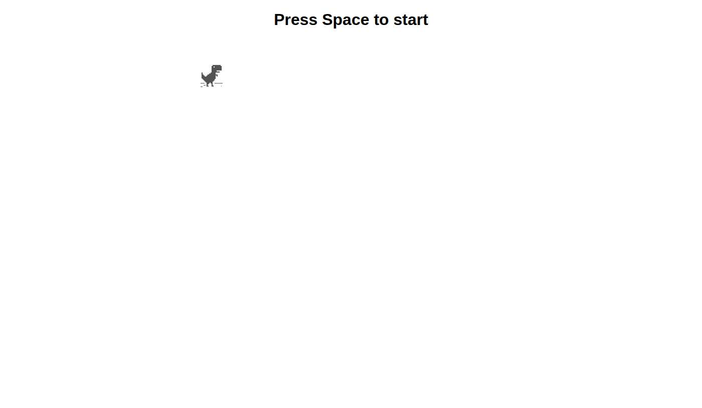
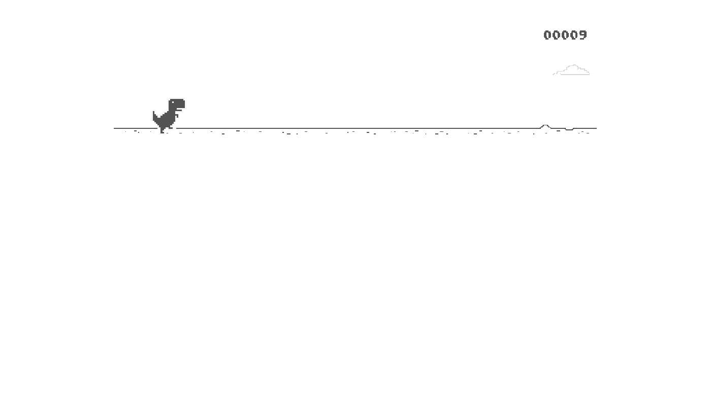

## Doom (Freedoom)

Fun 3. Quality 3. As a port it boots: the wad loads, the menu accepts Enter, and the touch pad (move, strafe, FIRE, USE) is on screen. As a Study Desk game it does not belong. It is a violent shooter. The boot screen is a debug log. This pass will not add weapons, damage, or levels.

Broken: the boot button sat on “STARTING…” while the engine log ran, which looks like a hang even though the menu then appeared.

Missing versus a family desk game: it is the wrong fantasy. A content line on the boot screen is the only change worth making, and even that is optional.

1. Do not tune combat.
2. Optional: one sentence on the boot screen that this is Freedoom and not a children’s game.
3. Leave the wad and the wasm alone.

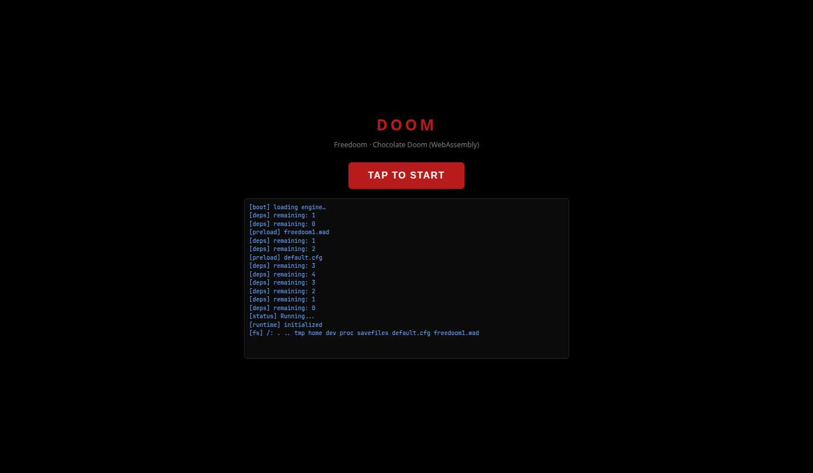
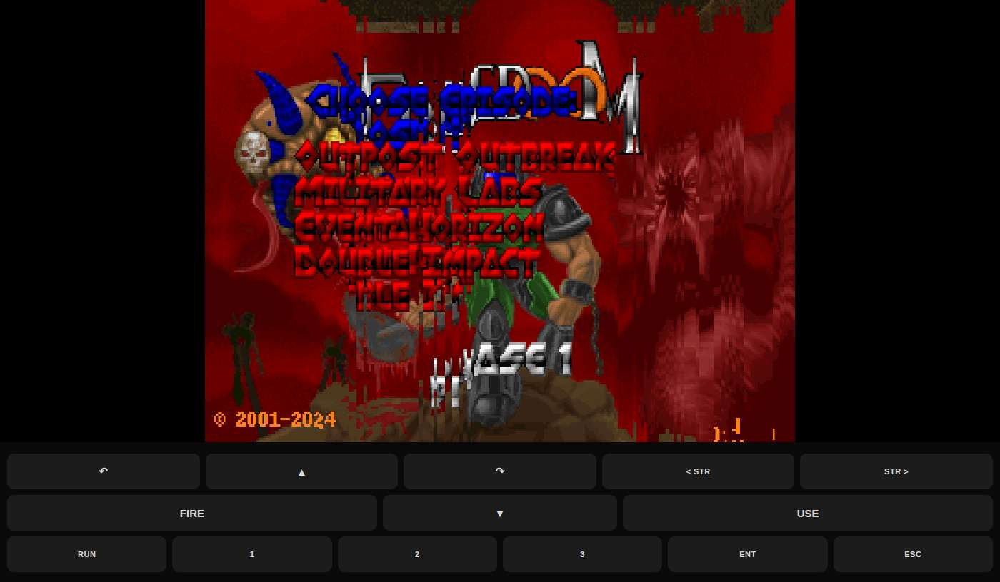

## Echo Vault

Fun 6. Quality 6. The Hush Gallery is a real stealth puzzle: one watcher, curtains, a relic, an exit. Later vaults add listeners and a third sentry, so the curve exists. The screen spends more pixels on “IF WAIT” essays than on the floor.

Boring: a move is an instant icon swap. You never see the sentry take a step.

Missing versus Hitman GO: a diorama where the guard turns, and a first room you can solve without reading a paragraph.

1. Vault 1: hide the long forecast until the second move, and show a three-step ghost hint to the curtain.
2. Animate the player and the sentry one tile when a turn resolves.
3. Leave vaults 2–4 and the mastery seals.

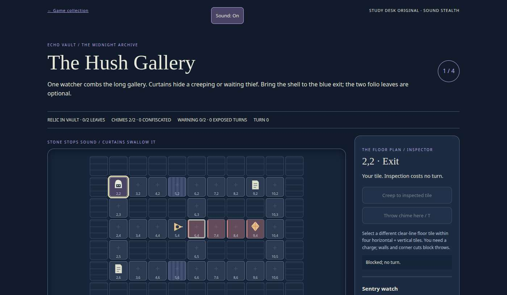
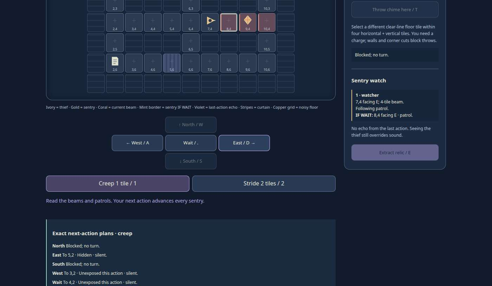

## Forge Arena

Fun 7. Quality 7. The hangar is a full commander shell: bays, credits, a division, and a BATTLE button that opens a mode picker (`openModes`) rather than jumping straight into a fight. This session stayed on the hangar, so the 3D fight was not played. The sheet already calls the battle a 7. Not a rewrite target.

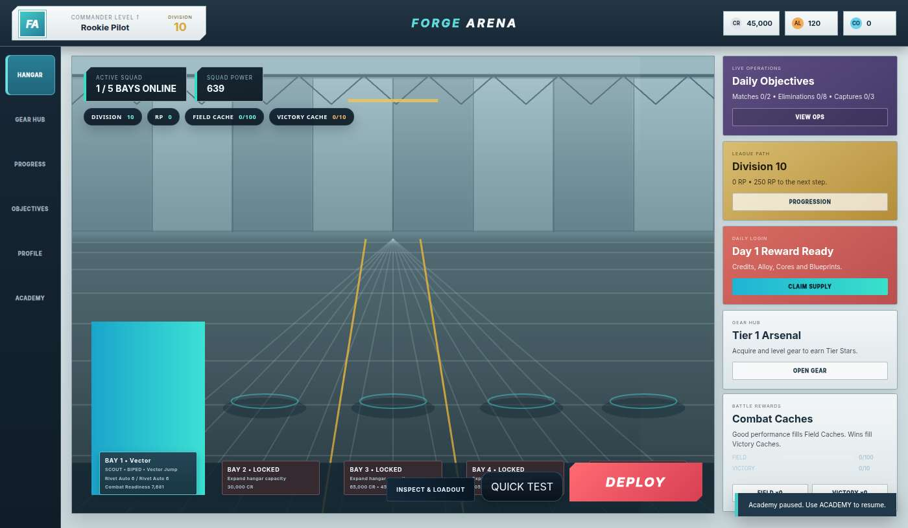
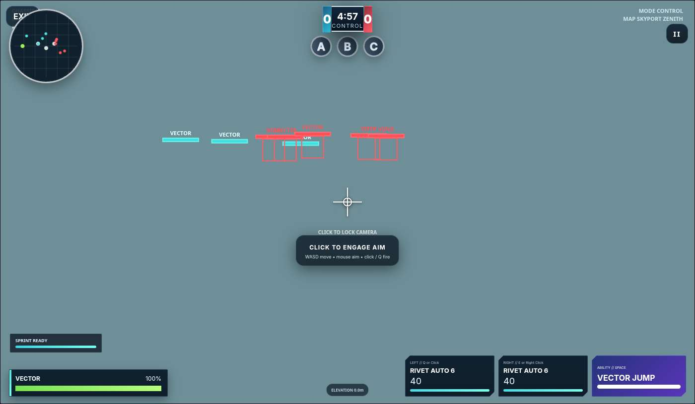

## Glasshouse

Fun 5. Quality 5. Exhibition 1 already offers seeds, water, shade, compost, lift, move, and crossbreeding. The goal is an order, which is good, and the garden is a grid of empty pots.

Missing versus Botany Manor: you should discover that a plant wants something, not be handed a genetics bench on minute one.

1. Exhibition 1: plant, water, deliver one flower. Hide cross, shade, and compost until exhibition 2.
2. A watered pot should visibly grow across the day advance.
3. Keep the save and the later exhibitions.

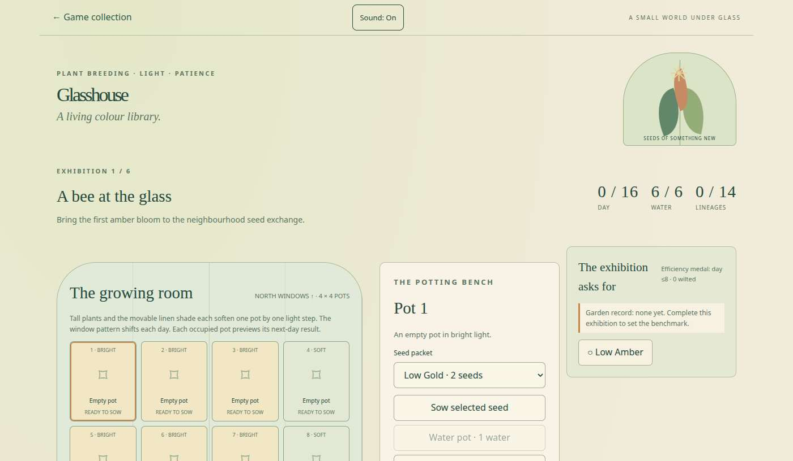
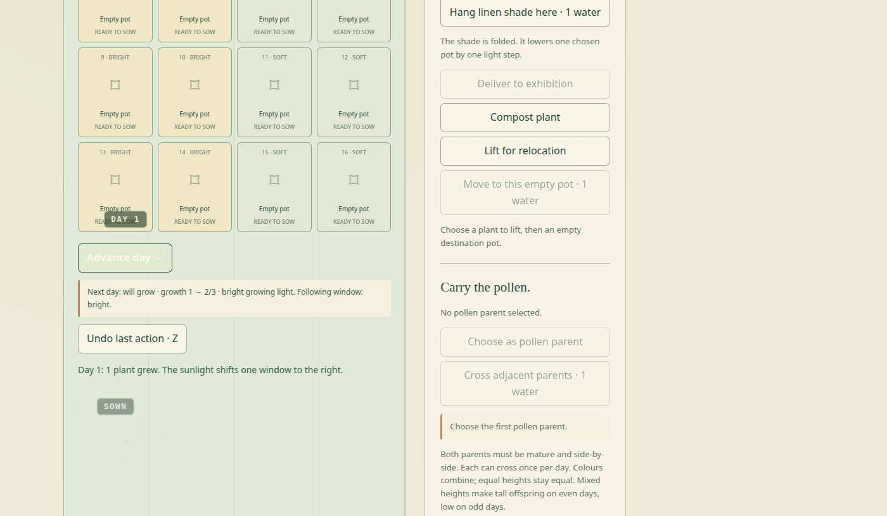

## Harbourlight

Fun 5. Quality 5. Draw from the boat to a coloured dock, avoid rocks. Chapter 1 asks for 3 boats and already scatters rocks, but the straight sea is empty, so the rocks do not teach anything. The side panel repeats the keys.

Missing versus Mini Motorways: a route that matters because something is in the way, and a boat you enjoy watching.

1. Chapter 1: one boat, rocks kept to the side, a wake while it sails.
2. Chapter 2: one rock on the straight line.
3. Index 0 only. Do not retune the other nine Afterlight toys.

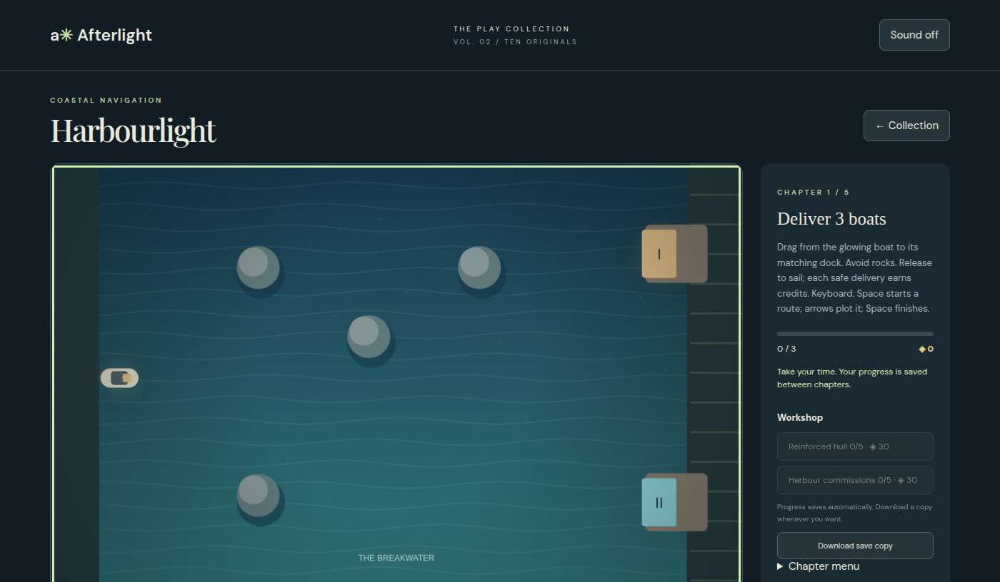
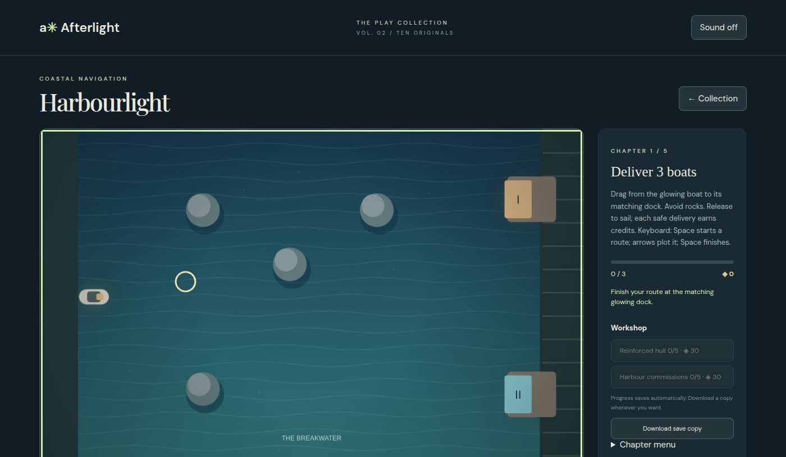

## Hextris

Fun 7. Quality 6. The hex plays: a block landed and the score moved. Pause and restart exist. It is a finished puzzle people already like. Dead Facebook and Twitter share links are still in the page (the boot text includes them; the buttons are the old rrssb block).

1. Remove or hide the share buttons that open Twitter and Facebook.
2. Slow the first 15 seconds so the first game is readable.
3. Leave the rotation rules.

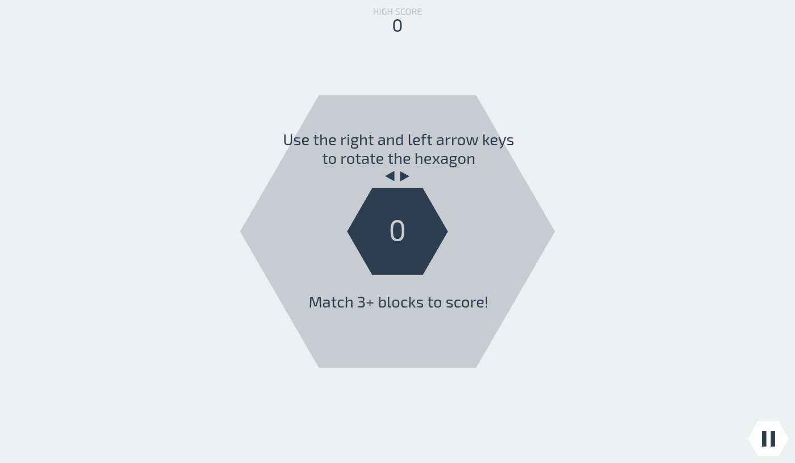

## Hollow Keeper

Fun 7. Quality 7. Title, pause, a rootkeeper tip, and a first hollow that asks for two thorn beds before anything harder. Dense, and already coached. Leave the sim.

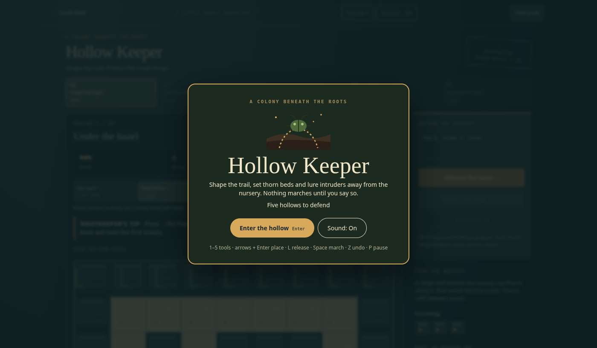
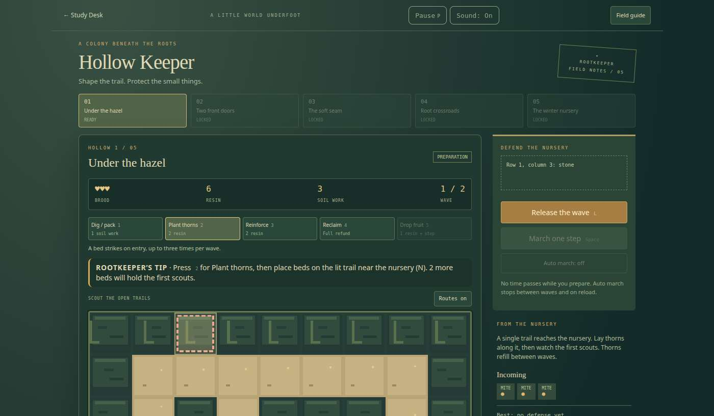

## Inkline

Fun 5. Quality 5. Move with cards, collect pages, reach the exit. Volume 1 already has shelves, blots, and a turn limit. A legal move is a tiny forecast number, not a stroke of ink.

Missing versus Slay the Spire: a choice that changes the run. Here the draft is real, and the board still feels like a grid puzzle wearing card labels.

1. Volume 1: no blots, two pages, and a higher turn limit. Later volumes keep the ink hazards.
2. Playing a card should leave an ink splash on the square you left.
3. Keep the deck save format.

## Kiln & Kind

Fun 4. Quality 4. Hold and wipe numbers off a vase. The target is 45 patches on every chapter, so there is no curve. A cleaned patch is a missing speck, not a picture coming back.

Missing versus a restoration game: the object should get more beautiful as you work, and the first vase should be small.

1. Chapter 1: 16 patches, and the cleaned ceramic shows a simple motif.
2. Chapters 2–5 climb back toward 45 and add finer dust.
3. Index 1 only.

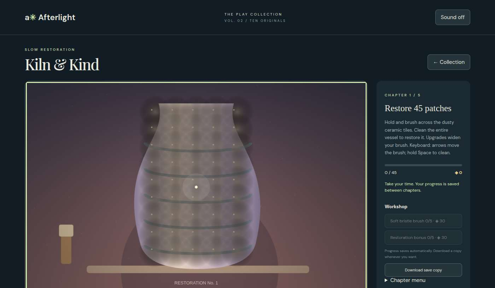
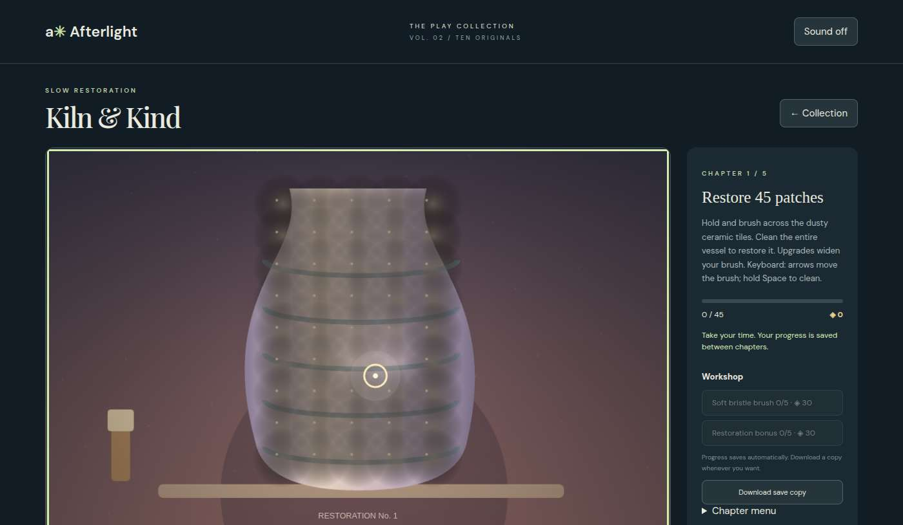

## Lanternwake

Fun 7. Quality 7. Title gate, a short first crossing, jars, oil, and a coach. At the bar. Leave it.

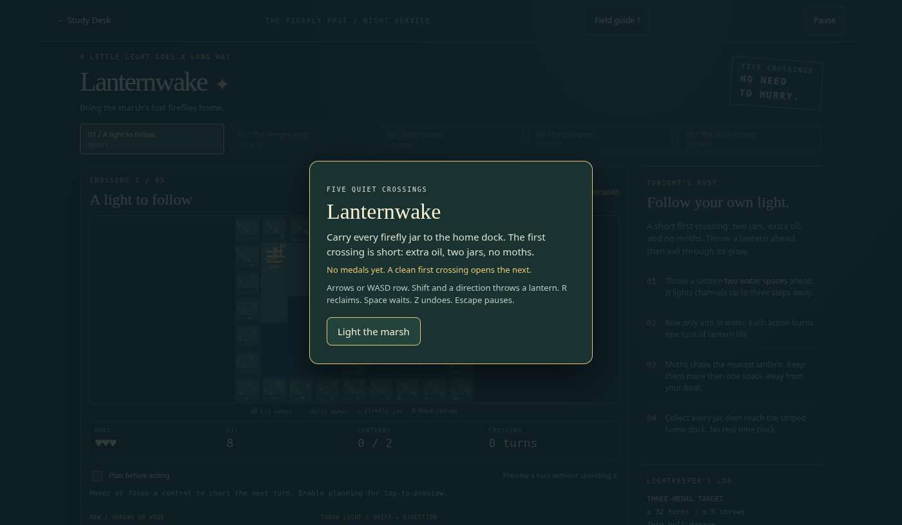
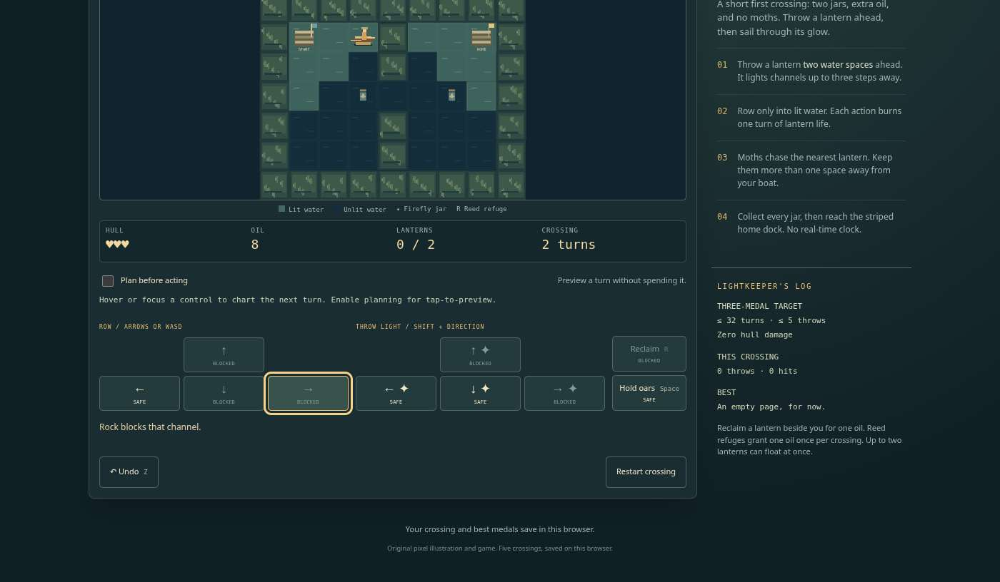

## Last Match

Fun 5. Quality 5. A lantern cone and sleeping shadows. Level 1 already fields a briar shade (2 health) next to two motes. The field reads as a diagram: grey discs, orange dots, a triangle of light.

Missing versus a gentle lantern game: the light should feel warm, and the first night should be one creature you understand.

1. Level 1: one mote, asleep until the flash, no briar.
2. The cone should brighten the ground it touches, and a stun should be obvious.
3. Levels 2–5 keep the mix. Assist aim can stay.

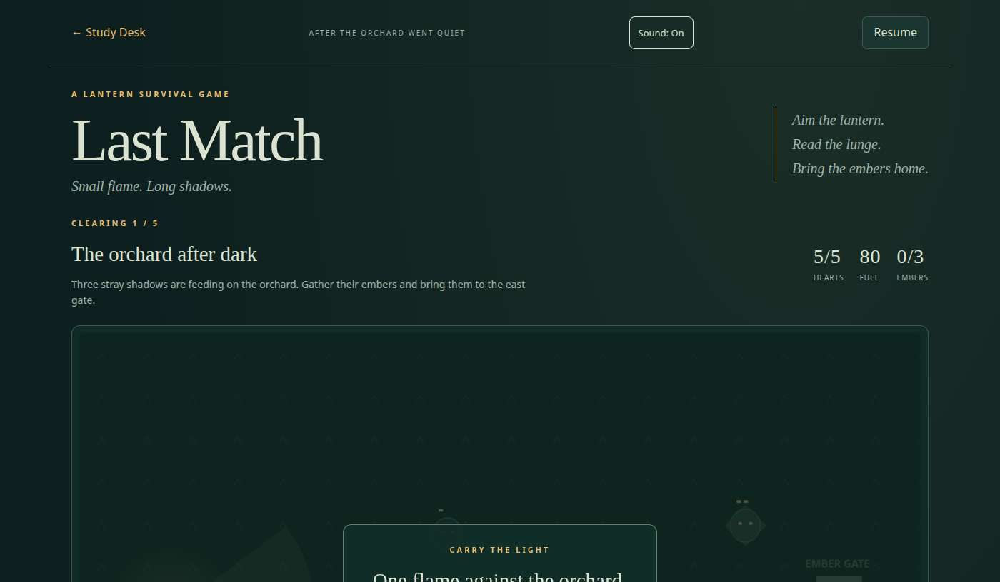
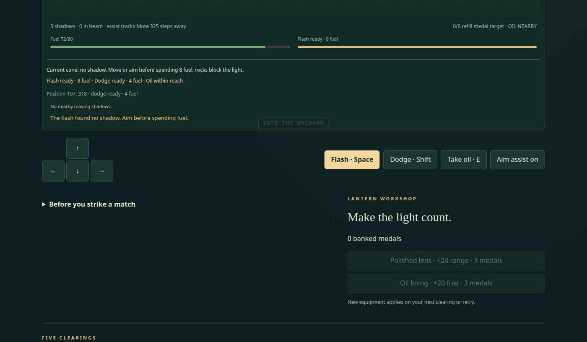

## Little Foundry

Fun 4. Quality 5. Weigh, heat, pour. Commission 1 is already an eight-section bell with a “body before rim” rule. The mould is a chart, not metal going in.

Missing versus a pouring toy: you should see the mould fill, and the first bell should be two sections with the heat band called out.

1. Commission 1: two body sections, no order rule, a coach on the heat band.
2. The section you pour should fill in the picture.
3. Commissions 2–6 keep their rules. Save version stays.

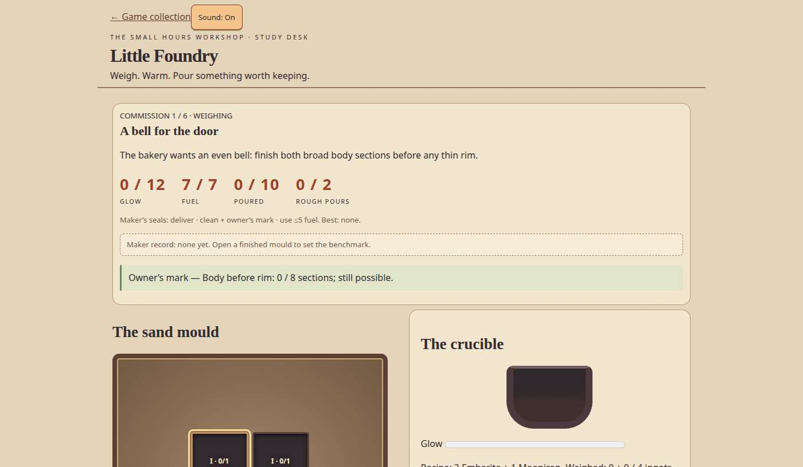
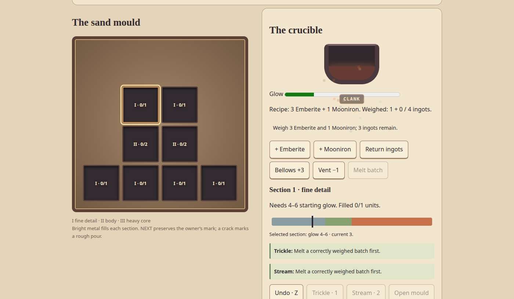

## Little Lake

Fun 7. Quality 8. Pixel water, a cast button, a journal, records. At the bar. The copy “7,000 species / AREA 1 / 8,000,000” makes the goal sound like a joke. Not a rewrite.

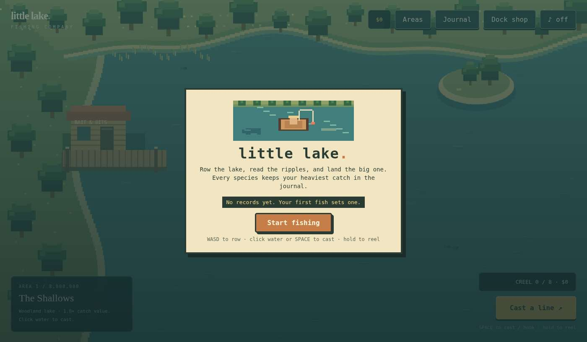

## Lost & Found

Fun 7. Quality 8. Title, a beach that reads as a beach, a coil, and a dig. At the bar. Leave it.

## Lucky Company

Fun 6. Quality 6. The offline club starts, the Lobby target is 90 chips, and the crew has 1,000. That curve is already in. This capture is the club panel (explore, first-person, wave, leave table). A battle was not played. Not a rewrite unless the 3D room is actually missing behind the panel; the session did reach play.

## Lumen Grove

Fun 4. Quality 4. Tap a seed three times and it blooms into the neighbours. Chapter 1 asks for 15 blooms on a random 6×5 of 0–2s, so the first chain is luck. A bloom is a number resetting.

Missing versus a light puzzle such as Lux: you should see the chain, and the first garden should be one you can finish on purpose.

1. Chapter 1: a fixed 3×3 with a seed already at 2, goal of 4 blooms.
2. A bloom should flash and paint its neighbours.
3. Chapters 2–5 keep the big grid and the rising goal. Index 9 only.

## After the improvement pass

Played again in the same headless Chrome. After frames for the games that changed are in `shots/after/`. Scores above are from that pass. Nothing here reaches the 7 bar except Hextris, which was already fun and only lost its dead share buttons.

**Astray, 2/2 → 6/6.** The maze, ball, and floor draw. The merged wall mesh had been frustum-culled, so the old black frame was an empty clear plus a shader warning from the unused lens-flare program. Level 1 is a 7-wide maze, arrows and an on-screen pad move the ball, and Esc or Pause holds it. The floor is still a dark concrete sheet and the exit is only a gap, so it is not an 8.

**Harbourlight, Kiln & Kind, Cloud Courier, Copper & Steam, Lumen Grove, 4–5 → 6/6.** Chapter 1 only, inside `games/afterlight/app.js`. Harbourlight asks for one boat and keeps the rocks off the straight line, with a wake while it sails. Kiln & Kind restores 16 patches and grows a flower as they clear. Cloud Courier asks for 3 parcels, spawns storms less often, and draws a shadow under the drone. Copper & Steam starts one turn from solved and paints the connected elbows gold before the outlet. Lumen Grove starts from a fixed chain and asks for 4 blooms. Later chapters, and the five M–Z toys in the same file, are unchanged. The keyboard test still passes.

**Bolt & Bristle, 5/4 → 6/6.** The header no longer says prototype. The first radio is dust only.

**Deep Pocket, 4/5 → 6/6.** Trip 1 is the reed edge, shallow, one Lantern Dace worth 12 shells. The second brief, the other banks, the other depths, and the habitat chart stay hidden until trip 2. Old completed saves still satisfy the easier goal.

**Little Foundry, 4/5 → 5/6.** The first bell’s glow band is wider, so a rough seam is harder to hit by accident. The mould, the recipe, and the fuel are the same, which is why fun only moves one point.

**Inkline, 5/5 → 6/6.** The first wing has no ink blots. Walls, pages, and the turn limit are unchanged.

**Circuit Garden, 5/5 → 6/6.** Season 1 hides the energy ledger and the weather strip until three modules are on the roof. Later seasons still open with the full forecast.

**Copper Cadence, 6/5 → 6/6.** Pause and Esc hold the crank, the feeds, and the shortcuts. P still belongs to Study Desk. The first chart is still a one-lane commission, so the curve cell in `GAME_QUALITY.md` stays fail.

**2048, 6/4 → 6/6.** New Game sits under the board. How to play is closed. Esc or Pause ignores swipes and arrows; R still restarts.

**Dino, 5/3 → 6/5.** A small Study Desk card names jump, pause, and a medal at 100. Esc pauses the existing runner. The Chrome sprites are unchanged, so the page still looks like the offline error underneath the card.

**Hextris, 7/6 → 7/7.** The Facebook and Twitter share row stays hidden, including on the game-over fade.

**Doom, 3/3 → 3/4.** The boot line says Freedoom is a violent shooter and is not for children. Combat, the wad, and the wasm were not touched. It is still the wrong game for this desk, which is why fun stays 3.

Left as they were, with after scores equal to before: After Hours, Afterlight’s shelf, Ashwake, Autumn Drift, Borrowed Gravity, Burrow Express, Counterweight, Echo Vault, Forge Arena, Glasshouse, Hollow Keeper, Lanternwake, Last Match, Little Lake, Lost & Found, and Lucky Company. Glasshouse’s first order needs a cross that is not in the seed bag, so hiding Cross would make it unwinnable. Last Match’s first enemy list is part of the save check. Echo Vault’s forecast is the puzzle. The 7 and 8 games were already at the bar.
