# Games audit, M–Z

Played 27 Oct 2026 in headless Chrome at 1400×816, served from this repo. Each folder under `games/` whose name starts with M–Z was opened, screenshotted, and given a short real input (a start button, a click or drag on the playfield, and a keyboard action where the game has one). Scores are from that session plus the rules in each `engine.js`. They are not the checklist in `docs/GAME_QUALITY.md`.

**Fun** is whether another round feels worth it. **Quality** is whether the screen, the goal, and the feedback feel finished. **7** is the house bar already set by Roof Runner, Tidepost, Underleaf, Tiny Wilds and Tea for Ghosts. **After** is the same session’s score once the curve pass landed. Unchanged games keep the before numbers.

Nightshift — Town Empire is a catalogue link to another site. It has no folder here and was not played.

## Priority

Weakest originals, in the order to improve them:

1. Queen of Cinders, Moss Market, Storm Signal, Pocket Expedition, Spore Kitchen. These are paperwork screens. The first stage already asks for the whole game.
2. The Nightshift shell (`games/nightshift`). Ten games share one toy loop, sound starts off, and contract 1 is already a grind.
3. Stone Song, Rain Catcher, Salt & Sail, Static Orchard, Threadbound, Scrap Orbit. The playfield is a real game. The first stage does not teach it.
4. Moonwell, Orchard Atelier, The Quiet Cut, Tidal Glass, Velvet Circuit. Their code lives in `games/afterlight`, which this pass does not edit.
5. Leave the 7s alone. Leave Pac-Man, Radius Raid and the ABA microgames as preserved third-party games.

## Scores

| Game | Folder | Fun | Quality | After fun | After quality |
| --- | --- | --- | --- | --- | --- |
| crisp-game-lib hub | micro | 3 | 3 | 4 | 4 |
| The Quiet Cut | the-quiet-cut | 4 | 5 | 4 | 5 |
| Queen of Cinders | queen-of-cinders | 4 | 5 | 6 | 6 |
| Moss Market | moss-market | 4 | 5 | 6 | 6 |
| Storm Signal | storm-signal | 4 | 5 | 5 | 6 |
| Pocket Expedition | pocket-expedition | 4 | 5 | 5 | 6 |
| Spore Kitchen | spore-kitchen | 4 | 5 | 6 | 6 |
| Grime Time | nightshift-wash | 4 | 6 | 6 | 6 |
| Rent Is Due | nightshift-rent | 5 | 6 | 6 | 6 |
| Garden Gone Rogue | nightshift-garden | 5 | 6 | 6 | 6 |
| The Last Leaf | nightshift-leaves | 5 | 6 | 6 | 6 |
| Parcel Panic | nightshift-parcel | 5 | 6 | 6 | 6 |
| Magnet After Midnight | nightshift-magnet | 5 | 6 | 6 | 6 |
| Lunchbreak Slime | nightshift-slime | 5 | 6 | 6 | 6 |
| Tidal Glass | tidal-glass | 5 | 5 | 5 | 5 |
| Orchard Atelier | orchard-atelier | 5 | 5 | 5 | 5 |
| Velvet Circuit | velvet-circuit | 5 | 5 | 5 | 5 |
| Stone Song | stone-song | 5 | 5 | 6 | 6 |
| Rain Catcher | rain-catcher | 5 | 6 | 5 | 6 |
| Salt & Sail | salt-and-sail | 5 | 6 | 6 | 6 |
| Static Orchard | static-orchard | 5 | 6 | 6 | 6 |
| Scrap Sandwich | nightshift-crusher | 6 | 6 | 7 | 6 |
| One More Metre | nightshift-mine | 6 | 6 | 7 | 6 |
| Mothlight | nightshift-moths | 6 | 6 | 7 | 6 |
| Nightshift lobby | nightshift | 6 | 6 | 6 | 7 |
| Moonwell | moonwell | 6 | 6 | 6 | 6 |
| Scrap Orbit | scrap-orbit | 6 | 6 | 7 | 7 |
| Threadbound | threadbound | 6 | 6 | 7 | 7 |
| Pac-Man | pacman | 6 | 5 | 6 | 5 |
| Radius Raid | radius-raid | 6 | 5 | 6 | 5 |
| Pocket Palaeo | pocket-palaeo | 6 | 7 | 6 | 7 |
| Ratchet Run | ratchet-run | 6 | 7 | 6 | 7 |
| Paper Odyssey | paper-odyssey | 6 | 7 | 6 | 7 |
| Reefwright | reefwright | 6 | 7 | 6 | 7 |
| Wellward | wellward | 6 | 7 | 6 | 7 |
| Roof Runner | roof-runner | 7 | 7 | 7 | 7 |
| Tidepost | tidepost | 7 | 7 | 7 | 7 |
| Underleaf | underleaf | 7 | 7 | 7 | 7 |
| Tiny Wilds | tiny-wilds | 7 | 7 | 7 | 7 |
| Tea for Ghosts | tea-for-ghosts | 7 | 7 | 7 | 7 |
| Lost & Found on the Moon | moon-salvage | 7 | 7 | 7 | 7 |

## micro

Fun 3, quality 3. Retired third-party collection (82 ABA Games / crisp-game-lib titles).

**Broken.** `games/micro/index.html` with no query calls `onLoad`, which expects `update`. The page is a grey field and the console repeats `update is not defined` (128 times in this session). There is no menu.

**Boring.** A named game such as `?bmath` or `?froooog` does boot. Bmath is a one-line sum. Froooog is a four-lane dodge with a tiny character. They last a few seconds and then loop. Survivor’s sampled canvas was a flat field.

**Missing next to Steam.** A collection page, like the one in *The Basement Collection* or *UFO 50*: a picture, a one-line dare, and a button. These toys are the opposite of that frame.

**Top fixes.** 1. An original index that lists the games and never calls `update` with no game loaded. 2. Leave the ABA `main.js` files untouched. 3. Keep the folder retired in the catalogue. Rewriting 82 third-party games is out of scope.

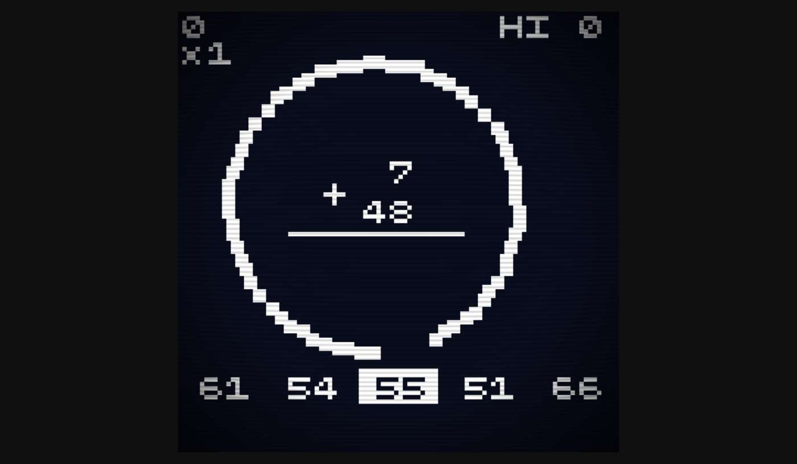

## The Quiet Cut

Fun 4, quality 5. Wrapper `start(8)` into Afterlight. Chapter 1 asks for 7 cuts on one moving blade.

**Broken.** Nothing crashed. Space during play registered “A little early or late.”

**Boring.** One bar, one green zone, then the same bar. Sound starts off. The workshop upgrades are two coin buttons. Five chapters only raise the count (`7 + chapter*2` in `target()`).

**Missing next to Steam.** *A Little to the Left* and *Unpacking* make the object the puzzle. *Timberman* and *The Pedestrian* at least change the timing pattern. Here the plank never changes shape.

**Top fixes.** 1. Chapter 1 should be 3 wide cuts with the green zone held still for a beat. 2. Sound on, and a click when the blade is in the zone. 3. Later chapters should move the zone, not only the quota. Code is in `games/afterlight/app.js`, outside this pass.

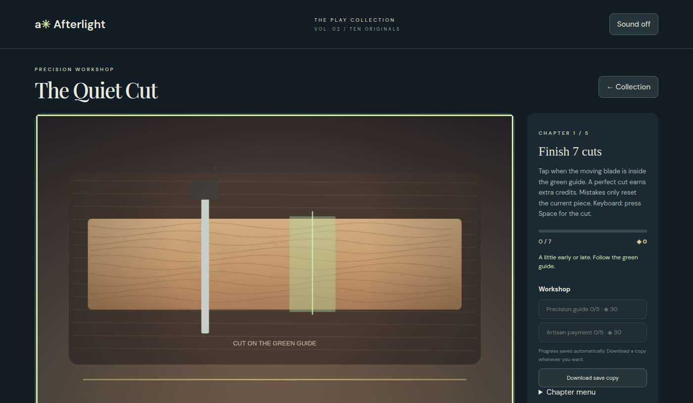

## Queen of Cinders

Fun 4, quality 5. Chapter “The warm nursery”: raise 3 brood before turn 18, with the ember line at `fire: 10`.

**Broken.** No page error. The board is a 7×7 of flat cells. Dig, dampen and inspect are modes over a spreadsheet.

**Boring.** Planning is real (trails, nurses, a fire clock) and then the screen stays a form. Chapter 1’s turn limit is 18. Later chapters allow 19, 20, 20 and 22. The first chapter is the strictest clock, with three supply trails already required. That is why Curve fails.

**Missing next to Steam.** *Empires of the Undergrowth* sells the ants: pheromone lines, castes you can see, a nest that grows. This has the logistics and none of the colony.

**Top fixes.** 1. Give chapter 1 a longer clock (about 24 turns), one supply already tunnelled, and a single highlighted dig. 2. Draw the fire edge and the trails on the soil, with dirt when you dig. 3. Keep medals and the save validator intact. Changing starting food or rock lists has to stay compatible with `valid()`.

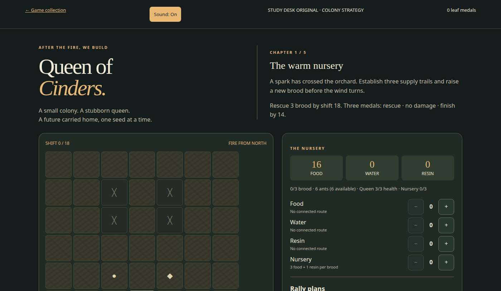

## Moss Market

Fun 4, quality 5. “The first awning” opens with five traders, eight goods, four recipes and three orders.

**Broken.** No crash. The first orders are a clinic shelf (balm), a kettle (2 tea) and a path light (a lamp). Starting stock is 2 moss, 1 berry, 1 thread, 3 timber. Tea needs 2 berries. A lamp needs a vessel and then more timber than you hold. The first market cannot be finished without a trade puzzle. That is the whole game on minute one.

**Boring.** Rates, shelves, overpay and declines are all visible, and none of them look like a stall. There is no customer walking up.

**Missing next to Steam.** *Moonlighter* and *Recettear* are a counter, a face, and a price. The dungeon is the other half. This is only the ledger.

**Top fixes.** 1. Market 1: two easy orders (balm and tea) with enough berries to brew, and a coach that names the next craft. Move the lamp to market 2. 2. Show the stall: stock as objects, a visitor when an order is open. 3. Keep the save version. In-progress market logs replay against `markets[index].start`, so a stock change rejects half-finished day-1 saves. Completed `profile.best` should still load.

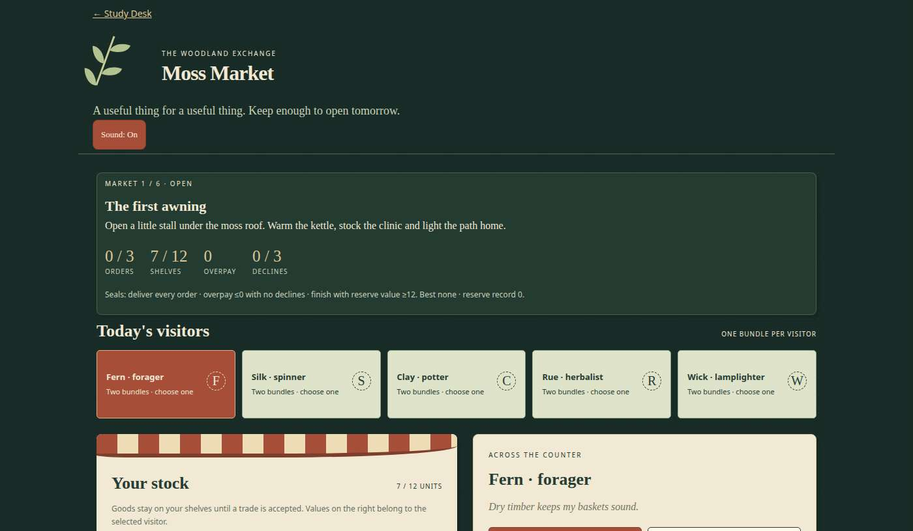

## Storm Signal

Fun 4, quality 5. Watch “The first squall”: three coded calls, two boats, a tide clock.

**Broken.** Rescan coast worked and spent radio charge. The symbols are easy to misread as decoration. Two misreads end the watch.

**Boring.** The harbour is a panel of buttons. Dispatch, tide phase and “pickup ≤ 6” are all on screen before you know what a code is. Later watches add a third boat and a fourth call, so the numbers ramp, but watch 1 is already the full deduction.

**Missing next to Steam.** *Return of the Obra Dinn* makes a wrong guess interesting because the scene answers. *Mini Metro* makes the route visible. Here the answer is a string compare.

**Top fixes.** 1. Watch 1 should open with one call already logged, and the notebook should highlight the matching coast before you can misread it. 2. Draw the boats leaving the harbour when you dispatch. 3. Raise the first misread allowance to 3, then bring it back to 2.

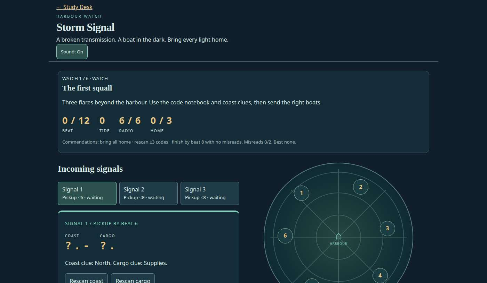

## Pocket Expedition

Fun 4, quality 5. “The moss stair” is eight nodes and a pack of 12.

**Broken.** Leave camp worked. The map is circles and straight lines. Sites are “Amber seed, 1 weight, value 2” with no place.

**Boring.** Every region is the same eight-node graph, 4–9 rations, 3 health, and a relic at the far node. Par values sit between 11 and 12. Region 1 is not a shorter walk.

**Missing next to Steam.** *The Long Dark* and *Curious Expedition* spend the fun on the route you can see: weather, a landmark, a choice to turn around. This is a logistics check.

**Top fixes.** 1. Region 1: five nodes, a rope already packed, 9 rations, and the relic two trails from camp. 2. Draw the trail you are on (ridge, marsh, tunnel) instead of a letter. 3. Keep the action log so old saves still replay.

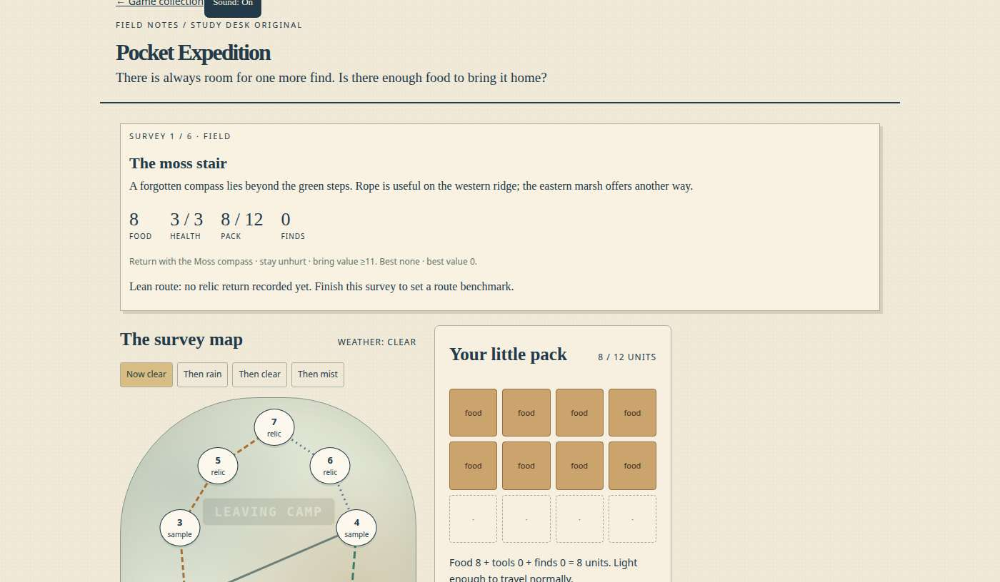

## Spore Kitchen

Fun 4, quality 5. Service 1, “The first lantern”, budget 30 actions, three dishes.

**Broken.** Planting a Velvet Button worked. The bed is a square with a letter.

**Boring.** Flavour is three numbers. You preview a distance, serve, and watch a star count. Budgets only fall from 30 to 26, while order vectors get less obvious. The first service already wants mixed traits such as `[3,0,3]`.

**Missing next to Steam.** *Potion Craft* stirs a map. *Overcooked* has a kitchen you can fail in public. A served dish here does not look like food.

**Top fixes.** 1. Service 1: two orders with a printed recipe that is correct, and a budget that cannot run out while you follow it. 2. Show the mushroom and the bowl changing colour. 3. Leave `version: 1` saves loadable. Completed services store earnings, not the recipe list.

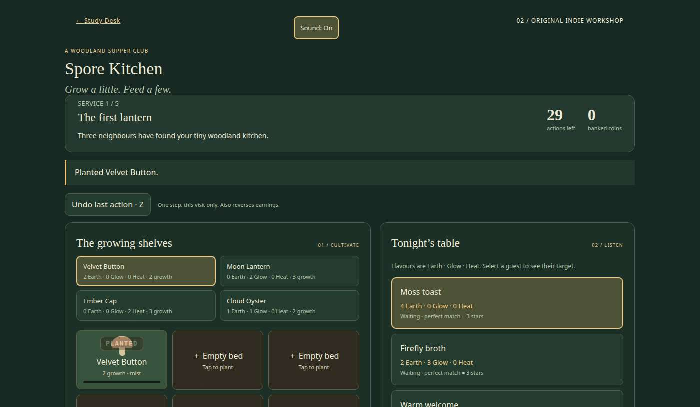

## Nightshift (the shell and the ten jobs)

The lobby and the ten `nightshift-*` folders boot the same app. `openGame(...)` skips the lobby. Sound starts off. Every sidebar opens with “Make a little progress. Then make your tools better.” Contract 1 of 6 is already a large quota (`18 + level*6`, eased only on phones). Upgrades are three coin bars, 0–8.

Compared with *Vampire Survivors*, *PowerWash Simulator* and *Cook, Serve, Delicious*, each job is one verb and a counter. The pixel scenes are readable. They are not yet a night you remember.

**Shared fixes.** 1. Sound on by default, with the toggle kept. 2. Contract 1 quotas cut by about half, and a one-line coach that names the verb (“Hold a gnome”). 3. Replace the shared status line with the job’s own line. Saves use `version: 1` and per-job ids. Quota lives in `makeRun`, not in the save, so old saves keep their coins and level.

### Grime Time (`nightshift-wash`) — fun 4, quality 6

Wash 160 tiles with a watering can. Two tiles cleaned, tank still 95%. The courtyard picture is the best of the set, and the job is a long drag. *PowerWash Simulator* pays you with the reveal. Here the reveal is the whole six-contract grind.

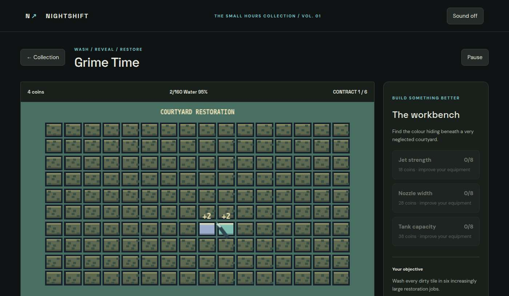

### Rent Is Due (`nightshift-rent`) — fun 5, quality 6

Smash appliances, pay invoice 105 inside about 98 seconds on contract 1. The timer is the difficulty. There is no “this one is a toaster, hit the glass” toy.

### Garden Gone Rogue (`nightshift-garden`) — fun 5, quality 6

Hold to sweep gnomes. A short hold away from them dropped the lantern from 100 to 88. The gnomes are close in colour to the grass. *Vampire Survivors* makes the threat obvious.

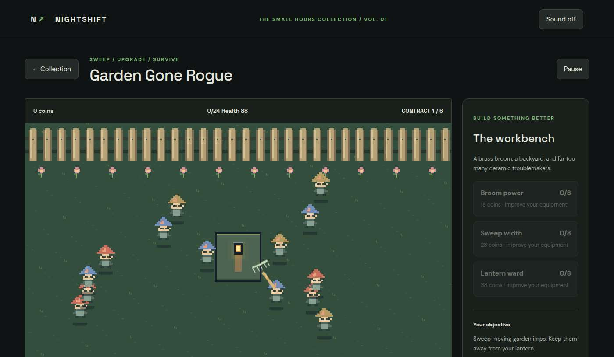

### The Last Leaf (`nightshift-leaves`) — fun 5, quality 6

Rake leaves into a bay, 0/36. The yard reads clearly. Pushing leaves with a cursor is the whole game, and contract 1 is already a full yard.

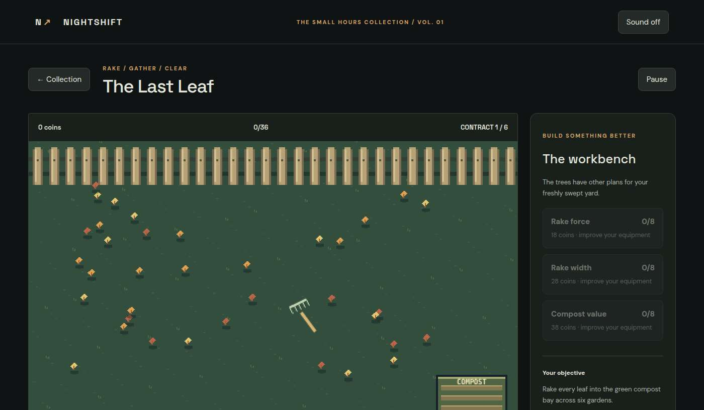

### Parcel Panic (`nightshift-parcel`) — fun 5, quality 6

Click a parcel, then a matching bay, 0/24. A mis-click breaks a streak before the colours have been taught.

### Magnet After Midnight (`nightshift-magnet`) — fun 5, quality 6

Cast and reel, tension on a meter, 0/10. The verb is good. The canal is a dark rectangle and the first contract does not show a slack line versus a snap.

### Lunchbreak Slime (`nightshift-slime`) — fun 5, quality 6

Guide a slime, eat crumbs, avoid red bots. It reads as agar.io in a break room. Contract 1 still asks for 24 snacks with bots already in the room.

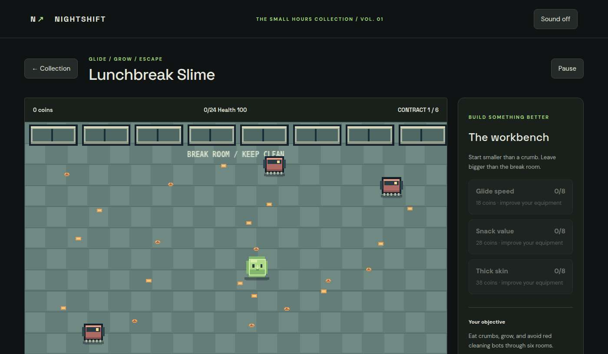

### Scrap Sandwich (`nightshift-crusher`) — fun 6, quality 6

Load three pieces, stop a needle in the green. The first click loaded 1/3 and the gauge was moving. This is the clearest toy in the set. The green zone does not grow friendlier on contract 1.

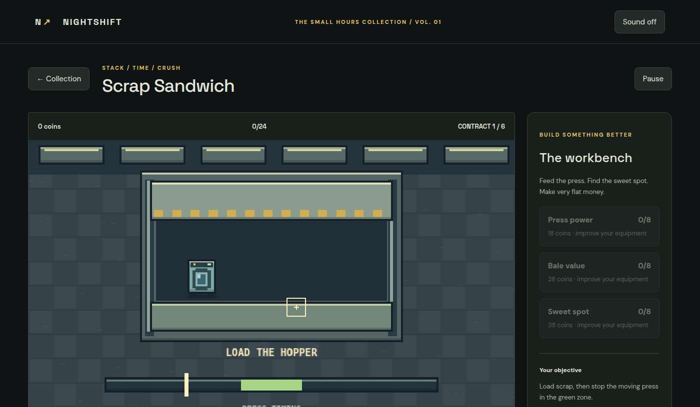

### One More Metre (`nightshift-mine`) — fun 6, quality 6

Dig rock that touches the tunnel. One block came out (1/160) and the shaft reads well. 160 blocks on contract 1 is a chore, not a descent. *Motherload* pays the dig with a new depth.

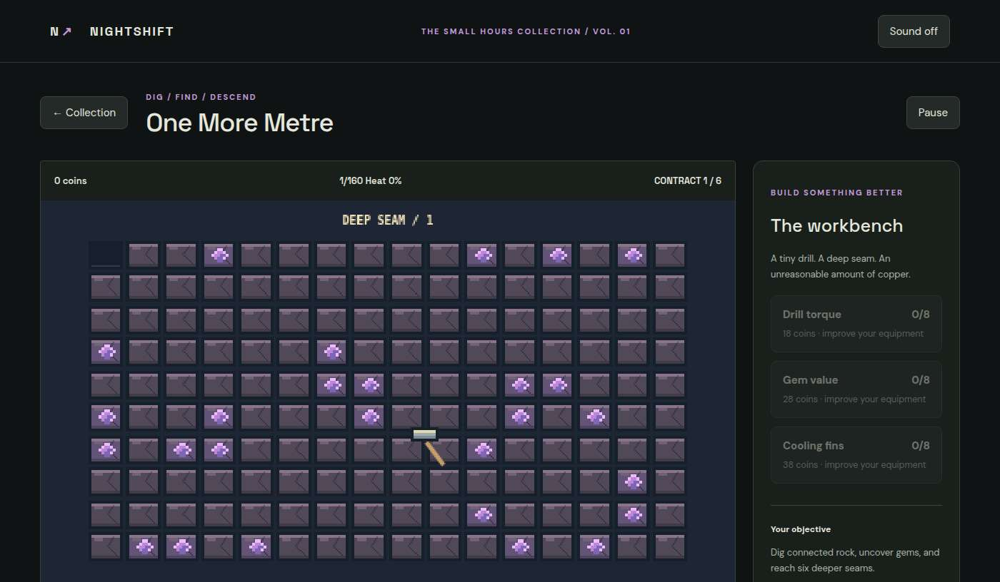

### Mothlight (`nightshift-moths`) — fun 6, quality 6

The net caught a moth (4 coins, 1/24) on a short hold. Pale moths versus red fireflies is a real rule. The quota hides it.

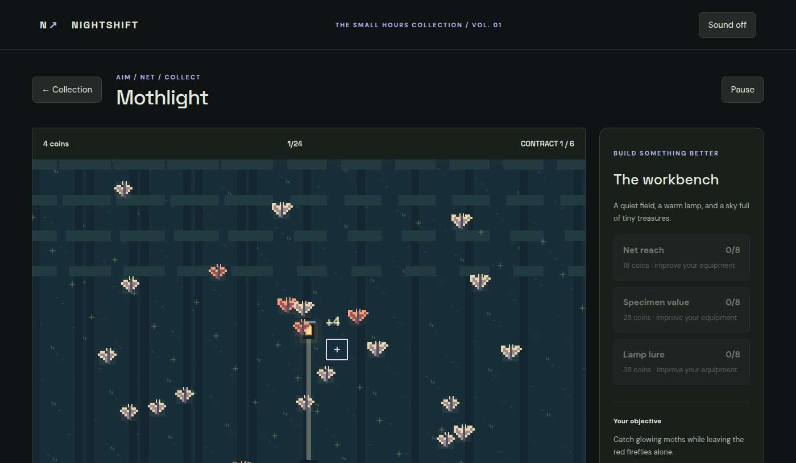

### Lobby (`nightshift`) — fun 6, quality 6

Ten cards, a title, and a click that opens Garden Gone Rogue. The lobby is the best screen in the collection. It hands you the same sidebar the individual folders do.

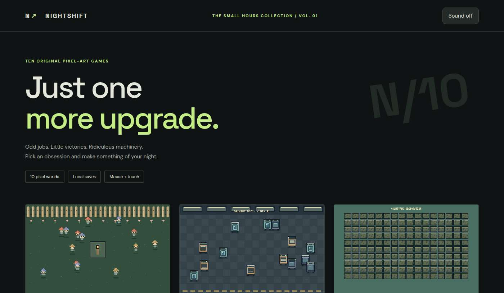

## Tidal Glass

Fun 5, quality 5. Afterlight `start(5)`. Chapter 1: bank 8 treasures. Dragging the sub immediately lost one treasure to a jellyfish (“Jellyfish bump: one treasure slipped away.”).

**Boring.** One hold action, red bubbles, a station in the corner. Chapters add to the quota (`8 + chapter*3`).

**Missing next to Steam.** A small sub game like *In Other Waters* or *ABZU* is about a place. This is a collectathon on a gradient.

**Top fixes.** 1. Chapter 1: 4 treasures, jellyfish that bounce you without stealing. 2. A glow on the station when the hold is full. 3. Code is in Afterlight, outside this pass.

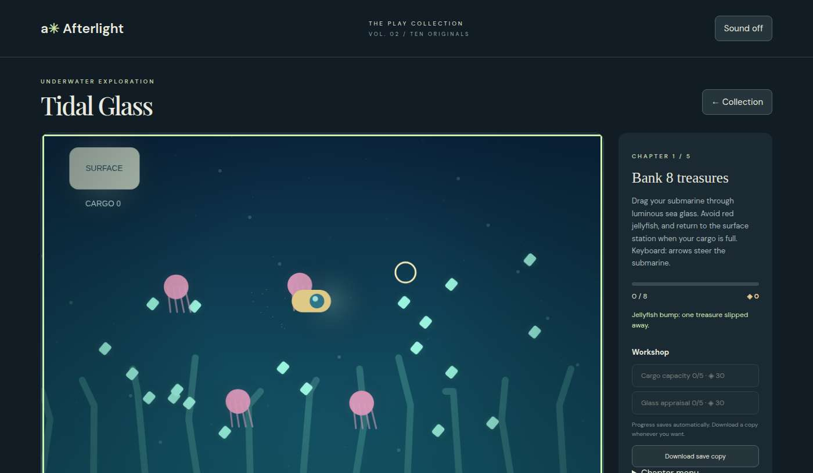

## Orchard Atelier

Fun 5, quality 5. Afterlight `start(6)`. Chapter 1: gather 14 fruit. Left and right move a basket. Purple fruit is the only twist. A golden pear is worth three, which the sidebar says and the tree does not show yet.

**Missing next to Steam.** *Kirby’s* falling-fruit minigames and *Overcooked* change the pattern. This raises 14 to 19, 24, 29, 34.

**Top fixes.** 1. Chapter 1: 6 fruit, no purple until chapter 2. 2. Telegraph the gold pear. 3. Afterlight, outside this pass.

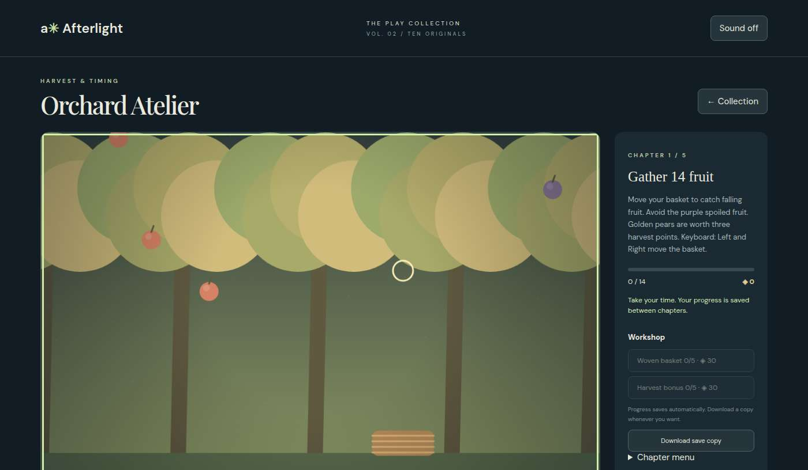

## Velvet Circuit

Fun 5, quality 5. Afterlight `start(2)`. Chapter 1: strike 12 bumpers. Flippers fired and the ball drained (“New comet. Time the flippers as it falls.”).

**Boring.** The table is a dark pool and two white dashes. Bumpers are not placed where you can plan a shot. Twelve hits is a long first chapter for a coin-flip.

**Missing next to Steam.** *Pinball FX* is a table you learn. This is a bar that counts bounces.

**Top fixes.** 1. Three bumpers in a fixed triangle, goal of 4 on chapter 1. 2. A click on each bumper. 3. Afterlight, outside this pass.

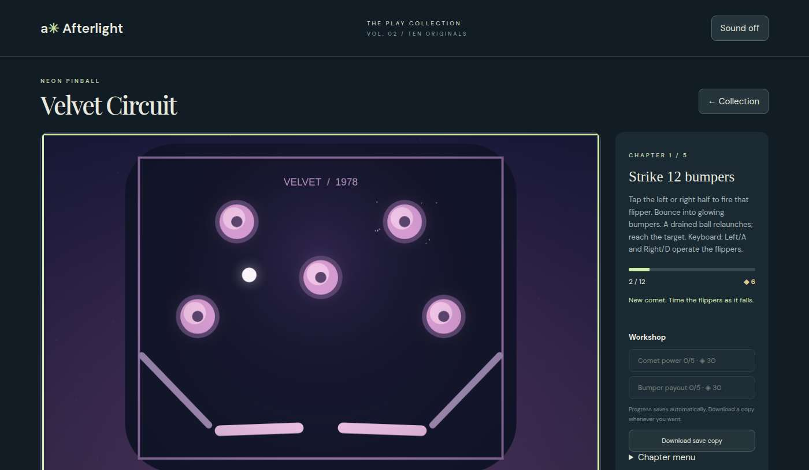

## Stone Song

Fun 5, quality 5. Seam “The waking wall”: two stones, shift only, par 5 moves, then perform eight beats.

**Broken.** Sound starts off in a game about listening. The target mask and the stone rows are both empty-looking until you already understand bits.

**Boring.** Later seams do add a rule (tune at seam 3, mute at seam 5). That ramp is real. Seam 1 still drops an 8-beat mask with no sung example.

**Missing next to Steam.** *Melatonin* and *A Dance of Fire and Ice* play the pattern before they ask you to. You hear the answer, then you play it.

**Top fixes.** 1. Sound on, and a Listen button that plays the engraving once before you shift. 2. Seam 1: four beats, two stones, the first stone already in place. 3. Keep `profile.best` length 6 so old medals still decode.

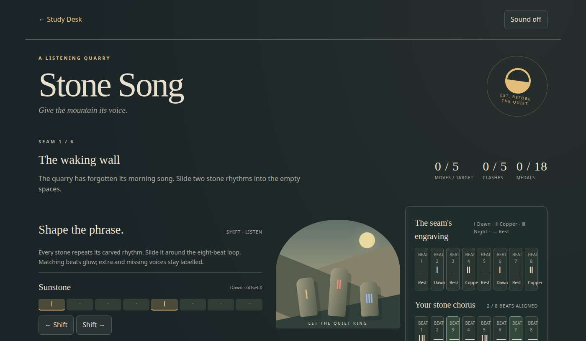

## Rain Catcher

Fun 5, quality 6. Dry Bell Village is a height grid, one cistern, three gardens, and a doorstep that floods.

**Broken.** Cut channel worked (“Channel cut to height 0”). The rules (height, head, closed cistern, three drinks) arrive together.

**Boring.** Map 2 and 3 add forks and a second cistern, so the maps do grow. Map 1 is still a full puzzle with a flood lose-state. *Timberborn* lets you watch the water miss.

**Top fixes.** 1. A first rain with one garden, the cistern already open, and one channel pre-cut. 2. Animate the flow step so a mistake is a puddle, not only a number. 3. Records are per district. A new first map must keep the same four-slot `completed` array.

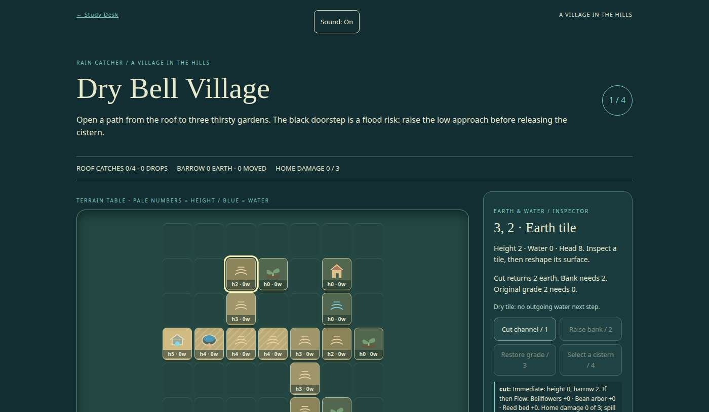

## Salt & Sail

Fun 5, quality 6. Lemon Quay is labelled fair-weather. It still has two rocks, three cargo shapes, list, sail, and a harbour approach.

**Broken.** Cast off is available once two contracts are packed. The hold grid is clear. The sailing chart is a thin channel and the rocks are easy to meet before you know what “reef the sail” means.

**Boring.** Later routes add wind and heavier engines. Route 1 already contains every system: rotate, lash, list, sail, rocks.

**Missing next to Steam.** *Dredge* makes the hold and the boat the same fantasy. Here the hold is a form and the boat is a dot.

**Top fixes.** 1. Lemon Quay: one required sack, no rocks on the first half of the chart, sail locked at a safe setting until the harbour mark. 2. Show list as the boat leaning, not only a percent. 3. Keep route index 0 saves. A shorter `length` is safe if in-progress `run.x` still validates.

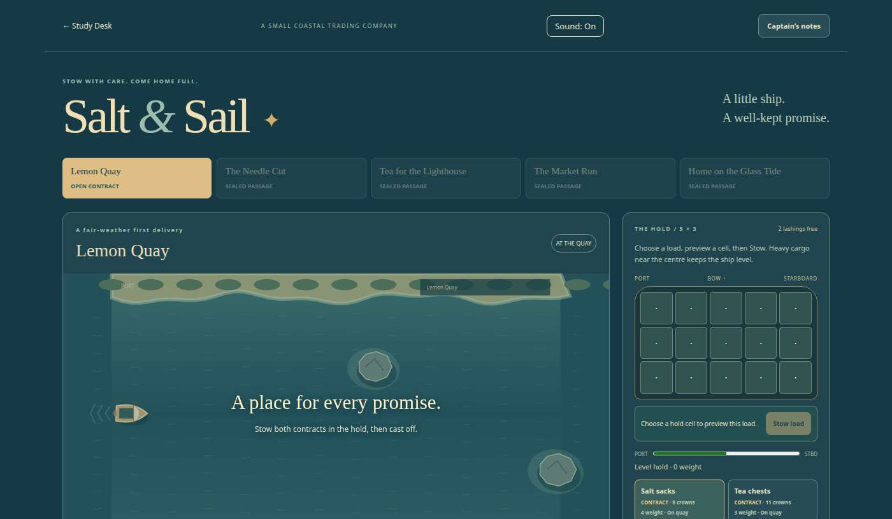

## Static Orchard

Fun 5, quality 6. Apricot Dawn has a title gate, three fruit, and three swarms. Types are all mites. Later groves add moths, beetles, hornets and a queen. That ramp is real.

**Broken.** Begin defense, then a fumble, and the line was already “One slipped past the trees.” Six mites per swarm and a chain rule (hold, release, link) are the whole game on swarm 1. There is no two-mite practice.

**Missing next to Steam.** *Plants vs. Zombies* teaches the peashooter on a single slow zombie. The lane is obvious. Here three launchers and a chain length are unexplained.

**Top fixes.** 1. Swarm 1 of Apricot Dawn: three slow mites in one cluster, and a ring that shows the arc before you release. 2. A “full charge” flash you cannot miss. 3. `records` stay four slots. Spawn counts live in `spawn()`, not in the save.

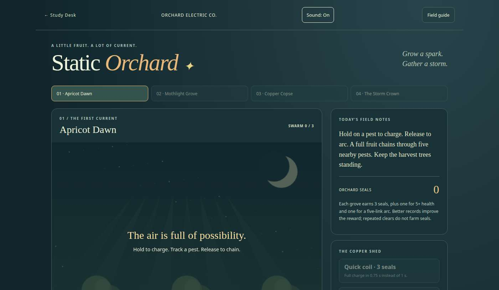

## Scrap Orbit

Fun 6, quality 6. “The lost lunchbox” has no rocks and light cargo. Later charts add rocks, swirl and heavy mass. The tug, the cable and the three targets read at a glance. Arrow thrust moved the ship (50 m/s, 1.4 s, hull 100).

**Boring.** Job 1 still asks you to learn coupling, winch length, brake and docking on three separate objects, with a 110 s medal time. There is no “bring the lunchbox only” rehearsal.

**Missing next to Steam.** *Hardspace: Shipbreaker* grades the cut and lets you push one piece until you believe the physics. The medal here grades a speed you have not practiced.

**Top fixes.** 1. Job 1: one crate already near the dock, the other two farther, and no medal clock until job 2. 2. A ghost line from the coupled cargo to the beacon. 3. `charts[0].cargo` length is validated at 3, so keep three items. Move the first one closer. Old ready-states rebuild from `run(chapter)`.

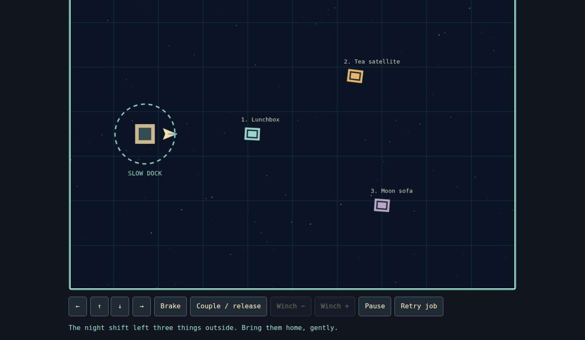

## Threadbound

Fun 6, quality 6. The best of the curve-fail action games. “The Loom Opens” has three pins, no wind, a checkpoint branch and a lantern. Hooking pin 1 worked and the thread drew. Later rooms add wind and a fourth pin.

**Boring.** The first gap is already a full swing. A fall costs a stitch and there is no one-pin practice. The sidebar is a long coach, which helps, and the pixels do the rest.

**Missing next to Steam.** *Grapple Dog* and a *Worms* ninja-rope level give you one hook and a safe landing before the wind. The swing itself is close.

**Top fixes.** 1. Room 1: two pins, a short gap, checkpoint under the first swing. 2. A landing puff and a tighter camera on the thread. 3. Four rooms stay four rooms so `profile.best` length 4 still decodes.

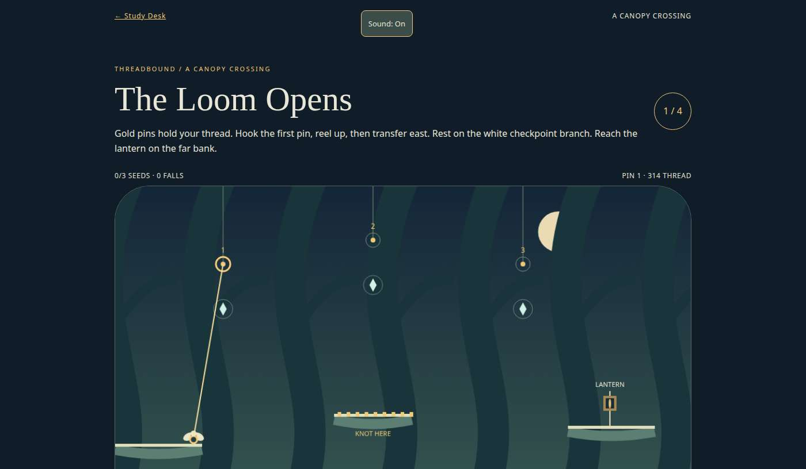

## Moonwell

Fun 6, quality 6. Afterlight `start(7)`. Chapter 1 is land 2 stars. Pull back, gravity bends, the moon is on the right. This is a real aiming toy, closer to *Angry Birds Space* than the other Afterlight games. Sound starts off. Failures reset the shot, which is fair. Five chapters mostly raise the count (`2 + chapter`).

**Top fixes.** 1. Sound on for the launch and the landing. 2. Chapter 3 should add a planet, not only a third star. 3. Afterlight, outside this pass.

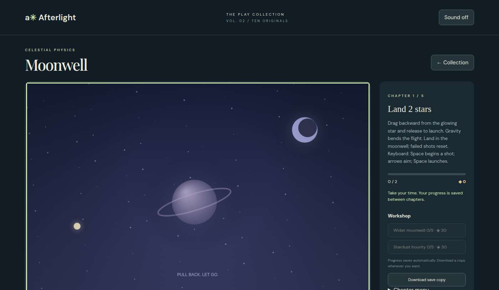

## Pac-Man

Fun 6, quality 5. Retired third-party remake. PLAY stays disabled while sprites preload. Waiting for the label, then clicking PLAY, drops the covers and shows the maze (arrow input after that). No page error.

**Boring for this desk.** Google font link, an author logo, and a game that is someone else’s Pac-Man. It does not need a Study Desk curve. It also should not be rewritten. A closer clone would copy a game we do not own.

**Top fixes.** 1. Leave it retired. 2. Do not reskin it. 3. The preload gate is fine. The first audit click missed because it landed before PLAY was enabled.

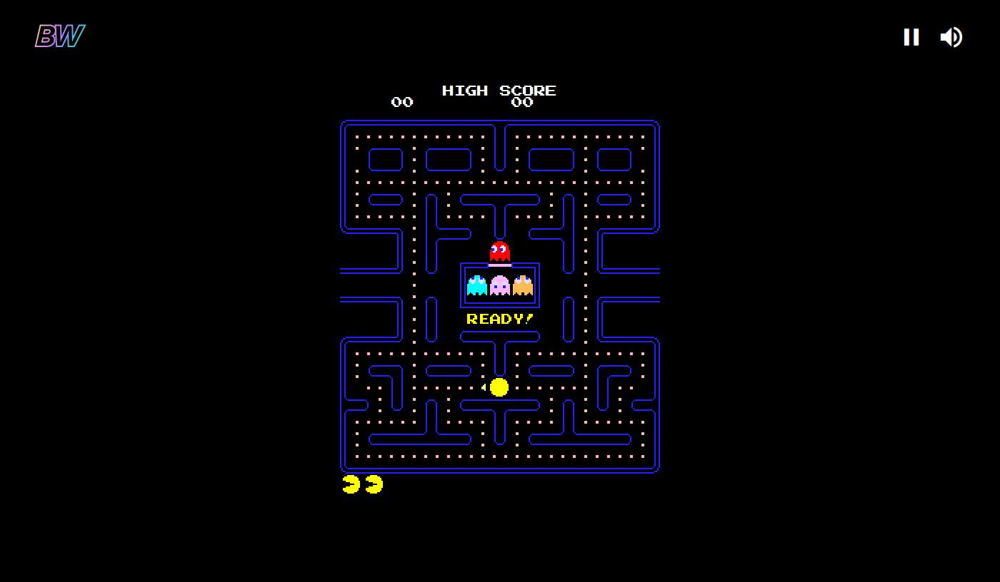

## Radius Raid

Fun 6, quality 5. Retired 2013 js13k shooter by Jack Rugile. It booted, the ship turned, and shots fired. No on-screen goal, no title card of our own, and the readme still says it wants Chrome and a high frame rate.

**Top fixes.** 1. Leave the third-party source. 2. Keep it retired. 3. A Study Desk pause line would be a local wrapper, and it is not worth a fork of a 13 kb game.

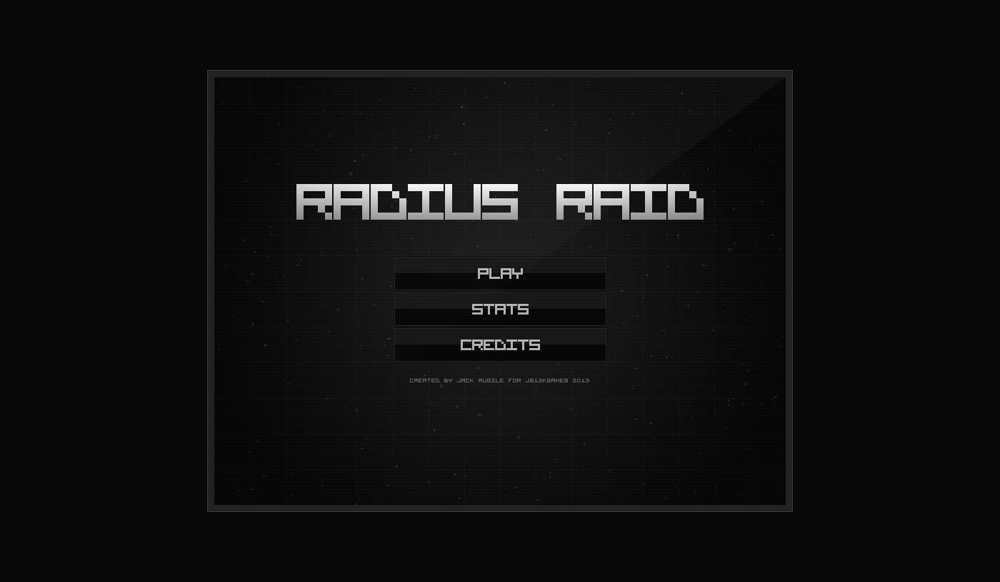

## Pocket Palaeo

Fun 6, quality 7. Ochre Creek, five tools, a field mentor, pause, sound. The title card is warm. The dig itself is still a numbered grid. *Dinosaur Fossil Hunter* shows the bone emerging. This shows a specimen card at the end, which the earlier notes already praise. First site is coached. Not a rewrite target.

## Ratchet Run

Fun 6, quality 7. Milk Run, Dispatch coach, lean, brake, hop. Ride started and the bike sat on a ramp. The side view is clean and simple next to *Trials*. The first course is the gentle one. Leave the courses. A later pass could add a landing puff. It is already at the bar for a small courier toy.

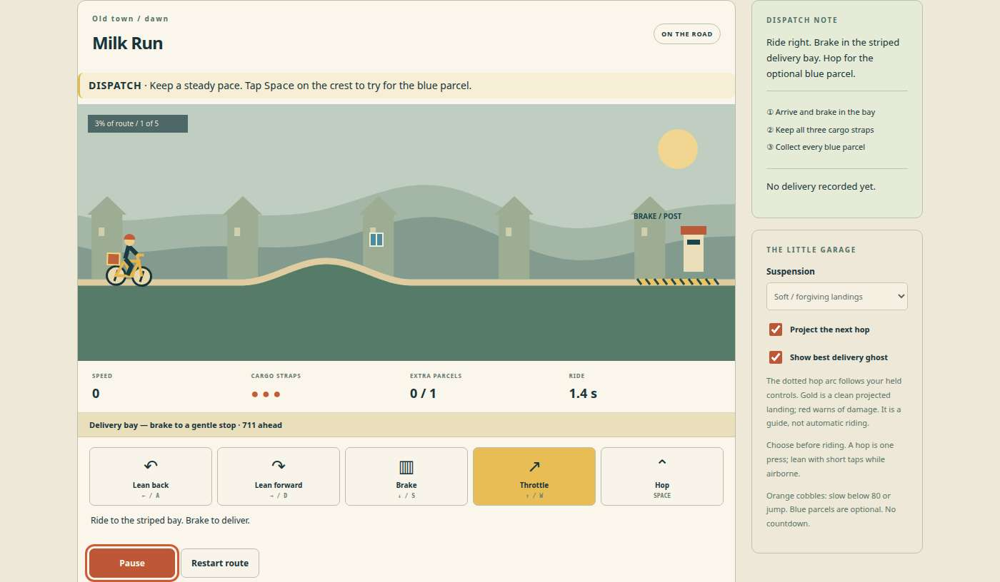

## Paper Odyssey

Fun 6, quality 7. Title card, five sealed charts, a fold move with a preview. “A shore within reach” is ready and the rest are sealed. Presentation is ahead of the fold, which I did not finish. *Paper Trail* is the comparison: the paper should crease on the map, not only in a diagram. Curve already passes. Leave it.

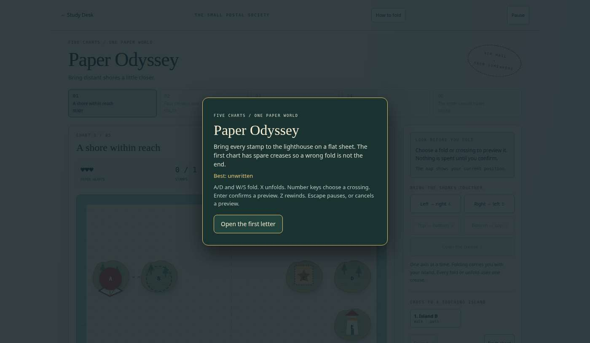

## Reefwright

Fun 6, quality 7. Title, five reefs, the first one open, rotate and plant. The grid is clear and a bit empty next to *Dorfromantik*’s tiles. Curve passes. Leave the rules. A later art pass could draw water between cells. Not this round.

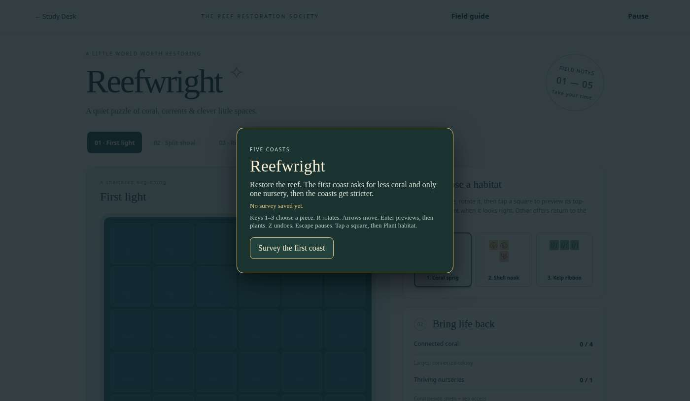

## Wellward

Fun 6, quality 7. Orchard Well, launch, personal bests, a coach. The bucket went down the shaft. The control strip is busy (slide, lower, haul, steady, lift, fill) and the shaft still reads. *Dredge*’s dive is moodier. The first well is the tutorial. Leave it.

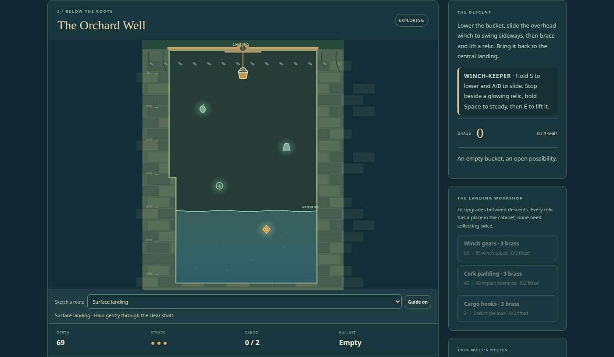

## Roof Runner

Fun 7, quality 7. The house bar. First Light, a flag, a postbox, three optional parcels. Move right and jump worked. The guide under the city is the pattern the other games are measured against. *Celeste* has more moves. This does not need them.

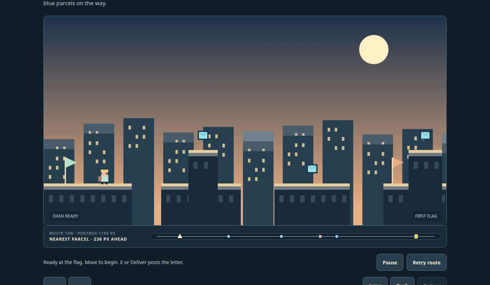

## Tidepost

Fun 7, quality 7. Milkglass Bay after Cast off. The ferry, the mail hold and the chart are all visible, and the first chart is the sheltered one. *Dredge* has a longer story. This already feels like a small voyage. Leave it.

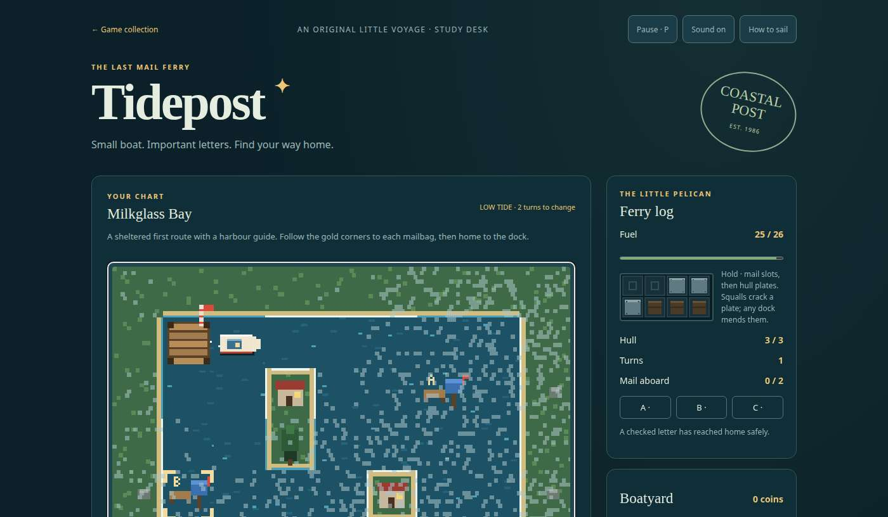

## Underleaf

Fun 7, quality 7. Title, then a side-view nest with a queen, food, and dig. The ant and the soil layers read at a glance. *The Ant Game* has more chambers. The first brood is already gentle. Leave it.

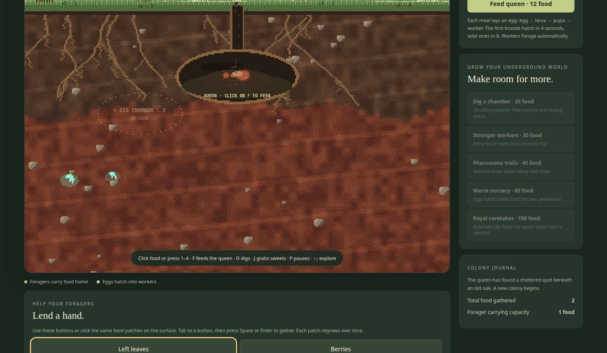

## Tiny Wilds

Fun 7, quality 7. Title, then Meadow Pond: a top-down bank, a cast, a vertical reel. The “100,000 types” line is a joke goal on a game that is actually about one pond at a time. The reel is the fun, and it is already there. Leave it.

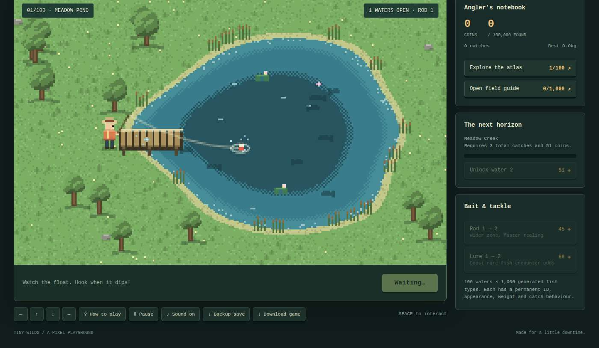

## Tea for Ghosts

Fun 7, quality 7. Title card, then Mabel at the counter with a speech bubble and a cabinet. Scoops, brew, offer. *Coffee Talk* has more visitors and a longer night. Six memories and a coached first cup are enough. Leave it.

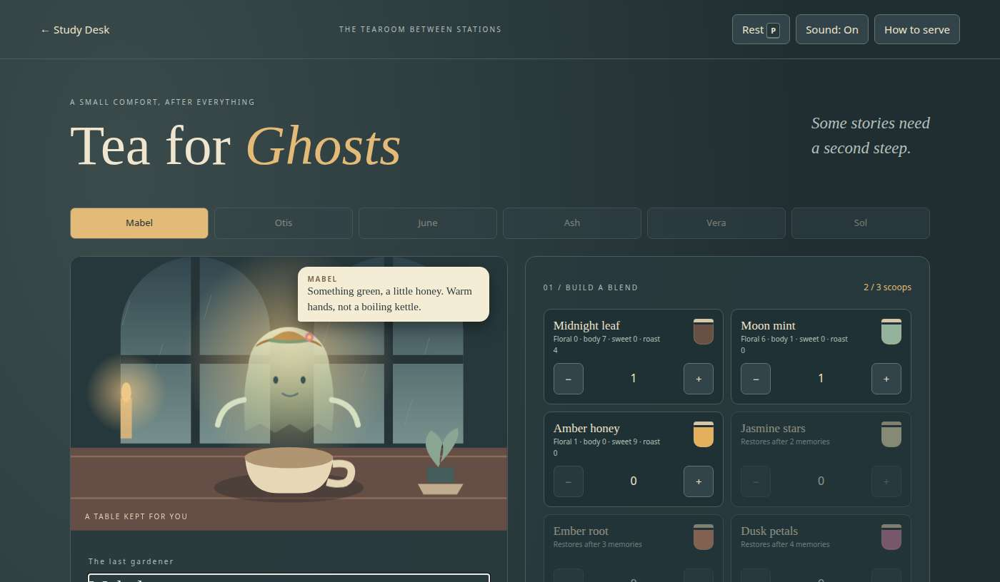

## Lost & Found on the Moon

Fun 7, quality 7. Clock in, a work order (single sock, +50%), a rover, and junk on a painted surface. Hold to winch. Three sectors, a best haul, and the duck. It is illustration more than strict pixel art, and it already plays. Leave it.

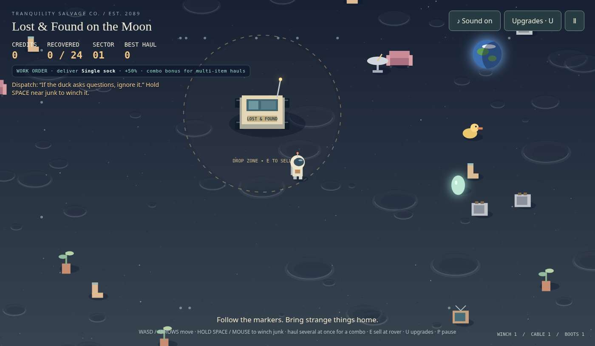

## After this pass

Same scoring rules as the open. A game moves only when the first minute actually changed. Art, goals and save version stayed. The house 7s, the near-bar digs (Pocket Palaeo, Ratchet Run, Paper Odyssey, Reefwright, Wellward) and the retired third-party games were left as played.

| Game | Before | After | What changed |
| --- | --- | --- | --- |
| crisp-game-lib hub | 3 / 3 | 4 / 4 | Original menu of the 82 names. No query no longer calls `onLoad`. The ABA `main.js` files are untouched, so a single toy is still a few seconds. |
| Queen of Cinders | 4 / 5 | 6 / 6 | Chapter 1 opens with the food trail already dug (tiles 31 and 30) and food at 14, so the old stock formula still holds. The coach says two ants on food, then dig east. The board is still a grid. |
| Moss Market | 4 / 5 | 6 / 6 | First awning starts with enough berries to brew. Orders are balm, tea and a berry basket. The lamp waits for the ferry. A failed in-progress day keeps the medal profile and starts that market fresh. |
| Storm Signal | 4 / 5 | 5 / 6 | Watch 1 logs Bell Reef (food crates) and tells you to send the Wren. The other two flares are still yours. The harbour is still a panel. |
| Pocket Expedition | 4 / 5 | 5 / 6 | A new moss stair packs a rope and 9 rations. A save that already chose its own gear is not rewritten. The map is still eight nodes. |
| Spore Kitchen | 4 / 5 | 6 / 6 | First service is ember toast, moss toast and moon soup, budget 36. The basket can serve the ember toast before you grow anything. |
| Grime Time | 4 / 6 | 6 / 6 | Contract 1 pre-clears about half the courtyard on every screen, not only a phone. |
| Rent, Garden, Leaves, Parcel, Magnet, Slime | 5 / 6 | 6 / 6 | Contract 1 quota is about half (at least 6). Slime has one bot. Garden gnomes walk slower. First invoice is 45 coins. Each job opens with a one-line hint. Sound starts on. |
| Scrap Sandwich, One More Metre, Mothlight | 6 / 6 | 7 / 6 | Same contract-1 cut. The mine shaft keeps about 72 closed blocks instead of 160. The toys were already the fun. |
| Nightshift lobby | 6 / 6 | 6 / 7 | The cards are the same. Sound defaults to on, which is what the other desk games do. |
| Stone Song | 5 / 5 | 6 / 6 | Sunstone already sits on the dawn beats. Sound starts on. Red shale is the one shift. |
| Salt & Sail | 5 / 6 | 6 / 6 | Lemon Quay needs the salt sacks only. Rocks, length and the replay tape are unchanged, so old voyages still decode. |
| Static Orchard | 5 / 6 | 6 / 6 | Apricot Dawn’s first mites move at speed 11 instead of 25. The swarm is still six, so the `wave * 6` tally holds. |
| Scrap Orbit | 6 / 6 | 7 / 7 | The lunchbox starts beside the dock. An unstarted job in an old save is rebuilt from the current chart. A job you already flew is left alone. |
| Threadbound | 6 / 6 | 7 / 7 | The first branch is wide enough to stand under the first pin. Anchor positions and ready-save coordinates are unchanged. |
| Rain Catcher | 5 / 6 | 5 / 6 | Dry Bell’s opening line now names the path, the bank and the cistern. The map and the rain tape were not touched, because a record must replay the same rain. Curve in `docs/GAME_QUALITY.md` stays fail. |

Left at the before scores, on purpose:

- Moonwell, Orchard Atelier, The Quiet Cut, Tidal Glass and Velvet Circuit are one-line wrappers into `games/afterlight`. That folder belongs to the A–L pass.
- Pac-Man and Radius Raid stay retired third-party. Pac-Man is someone else’s maze. Radius Raid is Jack Rugile’s 2013 js13k game, and it already plays.
- Roof Runner, Tidepost, Underleaf, Tiny Wilds, Tea for Ghosts and Lost & Found on the Moon were already at the house bar.
- Pocket Palaeo, Ratchet Run, Paper Odyssey, Reefwright and Wellward already clear the quality bar. Their first stages teach the verb. Rewriting them would spend the pass on games that do not need it.

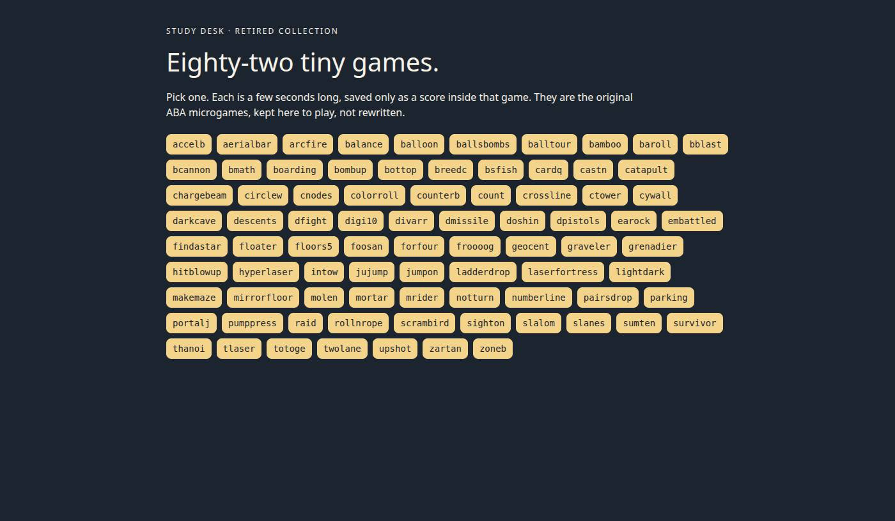

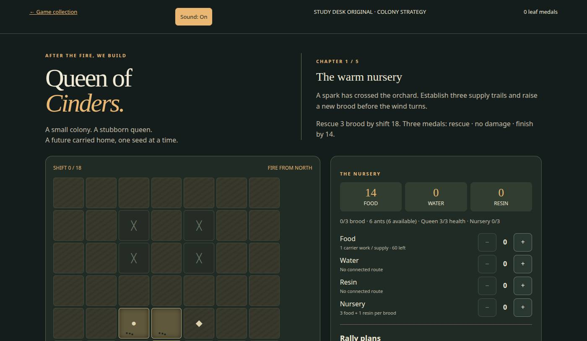

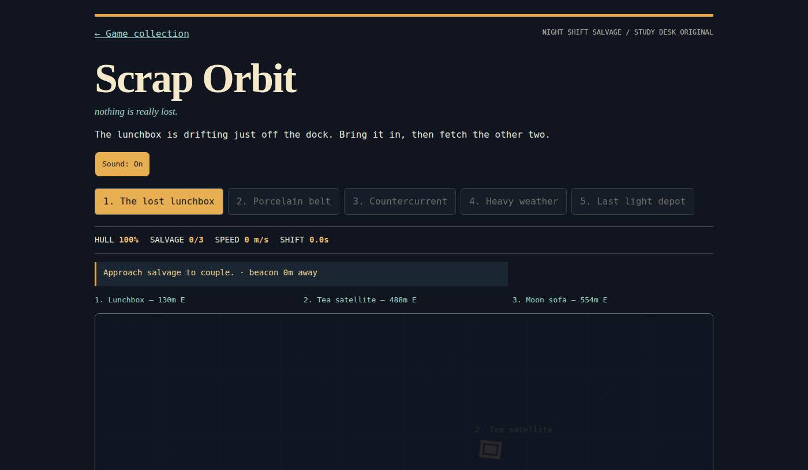

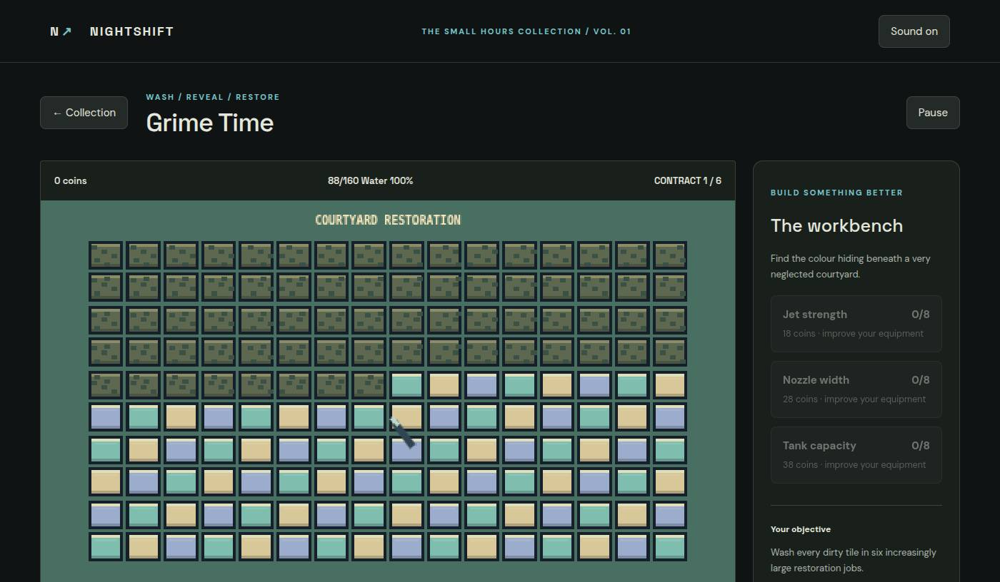
